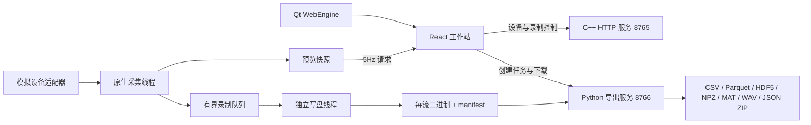
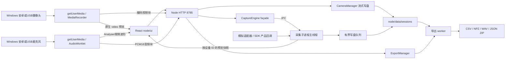

# Synapse 多模态采集工作站架构

最后更新于：2026-11-12

## 1. 项目概述

本地多模态采集软件，采用 React 前端与 Qt WebEngine 桌面窗口。C++20 进程负责模拟设备采集、缓冲和原始录制；独立 Python 服务负责主流格式导出。当前版本提供摄像头、麦克风、压力阵列、IMU 的模拟设备，真实 SDK/协议接入待实施。

另在 `node/` 提供独立 React + Node.js 原型，优先验证 SDK 数据链路。两套工程分别使用端口、前端构建和数据目录。Node 版不依赖 Qt/C++/Python；已安装并固定 npm `shroom-sdk@0.4.0`，接入手垫、手套、人体全身及 A 版鞋垫，通过实际 SDK Mock 与新产品契约帧验证采集和导出。真实串口设备由用户在前端选择后连接，硬件验收与 SDK 模拟验证分开记录。

## 2. 技术栈

| 分类 | 技术 | 说明 |
| --- | --- | --- |
| 前端 | React、TypeScript、Vite、Lucide、Canvas | 低频快照与独立 Canvas 绘制 |
| 桌面窗口 | Qt 6.12 / PySide6 / Qt WebEngine | 仅承载 React、管理启动与下载，不进入采集热路径 |
| Node 桌面窗口 | Electron 45.2.3、electron-builder 26.18.0 / NSIS | 原生标题栏、受限 preload、本地服务生命周期；独立窗口与安装包 |
| 采集服务 | C++20、CMake、MSVC | 独立采集线程和写盘线程 |
| 原生依赖 | cpp-httplib 0.18.3、nlohmann/json 3.11.3 | 固定 vendor 头文件及许可证 |
| 导出服务 | Python 3.11+、NumPy、h5py、PyArrow、SciPy、Pillow | 独立后台导出任务 |
| 存储 | mdaqbin-v1 二进制流、JSON manifest、localStorage | 录制在磁盘，组合在界面本地存储 |
| Node 原型 | Node.js 22.13+、child_process.fork、worker_threads、archiver 7.0.1、shroom-sdk 0.4.0 | SDK 在采集子进程主线程运行，导出使用 worker；独立 React/Vite 构建 |
| Node 界面验证 | jsdom 26.1.0、tsx 4.20.5、node:test | 验证 React 渲染错误、DOM 锚点丢失和根级恢复界面 |
| Node 摄像头 | getUserMedia、MediaRecorder、原生 video、Node 异步文件 I/O | 接入 Windows 已识别的安卓/USB 摄像头，编码视频与传感器关联同一会话 |
| Node 麦克风 | getUserMedia、AudioContext / AudioWorklet、原生 audio、PCM16 WAV | 独立音频卡片与实时波形；统一会话起停，原始 PCM 流式写 WAV |
| SDK 接入 Agent | Electron utilityProcess、net.fetch、safeStorage、Responses 工具调用 | 独立模型配置；导入、对话生成、显式测试、版本绑定安装；不经过公共 HTTP 执行代码 |
| SDK 文档读取 | mammoth 1.13.0、pdfjs-dist 6.5.438、yauzl 3.4.0、受限 worker | 本地提取 DOCX 正文与带页码的 PDF 文字层；分页发送文本，不执行宏、附件或 OCR |
| Agent 消息显示 | react-markdown 10.1、remark-gfm 4 | 标题、表格、列表、代码块；进入与切换时显示最新消息，Enter 发送且保留输入法组词，Shift+Enter 换行；禁用原始 HTML |
| SDK RTSP 媒体桥接 | ffmpeg-static 5.3.0（内置 FFmpeg 6.1.1）、受管子进程、PPM/RGB8 | 模型读取通用能力后自行生成适配器；实际尺寸校验、首帧门禁与无帧超时，原始录制不隐式缩放或限帧 |
| 模型目录 | Shroom 公共 model-catalog API、128 KiB JSON 校验、本地缓存 | 与 shroom1.0 共用模型目录；预设服务商/模型和自定义连接，目录不接触凭据或 SDK 内容 |
| SDK 扩展运行时 | Node 子进程、二进制 IPC、声明式 plugin.json | 每个实例独立进程，统一原始录制与低频预览，驱动异常不终止 HTTP |
| SDK 原生 C ABI | Koffi 3.3.7、包内共享库、受管 native 上下文 | 已支持 Windows x64 C 导出函数；异步 FFI、帧内存复制与生命周期约束，不是 C++ 类绑定或权限沙箱 |
| SDK MJPEG 保存 | 可变长 MDAQBIN1、原始 JPEG、浏览器异步解码 | 采集无需逐帧解码 RGB；保留原字节与源序号，预览限频且独立标记错误，录制期质量快照随清单保存 |

## 3. 目录结构

```text
数采/
├─ CMakeLists.txt
├─ frontend/                  React 界面、Canvas 预览、API 客户端
├─ desktop/launch.py          Qt WebEngine 窗口与服务生命周期
├─ native/
│  ├─ include/                设备描述、批次格式、采集引擎接口
│  ├─ src/                    模拟适配器、引擎、HTTP 服务
│  ├─ tests/                  原生内核与 HTTP 验证
│  └─ vendor/                 固定原生依赖及许可证
├─ tools/
│  ├─ session_data.py         有界二进制 reader 与 schema 校验
│  ├─ export_session.py       各格式导出与 ZIP 打包
│  └─ export_server.py        异步导出 HTTP 服务
├─ tests/                     Python 导出验证
├─ scripts/bootstrap.py       本地依赖安装与构建
├─ scripts/smoke_test.py      跨进程集成验证
├─ docs/DEVICE_ADAPTERS.md     真实设备接入说明
├─ node/                     独立 Node.js 原型（说明见 node/README.md）
│  ├─ ui/                    React 传感器目录/展示卡片、SDK 连接 hook、错误恢复及回归验证
│  │  └─ src/               LivePreview / 数字渲染、viewport-layout / workspace-display.css、任务与标记组件 / task-workflow.css
│  ├─ src/server.mjs         HTTP 8785、静态页面和安全下载
│  ├─ src/camera-preview.mjs 按可见 MJPEG 流订阅的二进制实时预览、背压与连接清理
│  ├─ ui/src/camera-preview-stream.ts 有界二进制帧解析、取消与有限重试
│  ├─ src/startup-status.mjs 重复启动时核验现有服务和数据目录，返回可访问地址
│  ├─ src/serial/           串口占用查询、短期释放凭证及隔离的 Windows 系统调用
│  ├─ src/integration/      SDK 文件工作区、受限 Agent 工具、Responses provider、测试与原子安装
│  │  └─ storage.mjs        大包元信息预检、流式哈希复制、磁盘空间检查与取消/来源一致性校验
│  ├─ src/integration/document-reader.mjs / document-reader-worker.mjs  DOCX/PDF 本地解析、资源上限、分页和内存缓存
│  ├─ src/integration/runtime-capabilities.mjs  供模型读取的通用文档/RTSP/原生 C ABI 能力描述，不返回厂商适配器源码
│  ├─ electron/integration-model-catalog.mjs / src/integration/model-catalog-defaults.json  Shroom 模型目录、有效缓存及随包目录
│  ├─ ui/src/AgentModelSettingsPanel.tsx  模型连接选择、目录刷新、自定义模型与密钥清除
│  ├─ src/plugins/          插件清单契约、独立 host、设备管理与数据校验
│  │  ├─ media.mjs          随包 FFmpeg 自检、RTSP 子进程、实际帧尺寸与断流检测
│  │  ├─ native.mjs         Koffi 共享库路径校验、C 函数/异步 FFI、V8 自有帧内存复制与进程级库寿命
│  │  └─ lifecycle.mjs      SDK 停止清理 10 秒、父进程兜底 11 秒的共享期限
│  ├─ src/integration-maintenance.mjs  测试/安装与采集启动互斥的可续期维护租约
│  ├─ ui/src/SdkAgentWorkbench.tsx / usePluginConnections.ts / plugin-types.ts / sdk-agent.css  SDK 接入工作台与动态传感器
│  ├─ ui/src/AgentMarkdown.tsx  Agent Markdown 渲染和内容/链接边界
│  ├─ docs/sdk-plugin-contract.md  厂商 SDK 适配协议、原生依赖与时钟限制
│  ├─ docs/hx-d350-integration.md  厂商资料依据、双目端口冲突、IMU/时钟与原始数据容量说明
│  ├─ docs/orbbec-integration.md  Agent 生成的 RGB 原生适配器、安装入口与无硬件验收范围
│  ├─ electron/             main/preload、服务子进程及权限边界、窗口图标
│  ├─ electron-builder.cjs  Windows x64 / NSIS 配置，明确排除数据和本机授权
│  ├─ scripts/start-desktop.mjs / check-desktop-package.mjs  桌面启动和产物验证
│  ├─ scripts/check-microphone-browser.mjs / fixtures/      Electron 合成音频与 WAV 全链路烟测
│  ├─ ui/public/audio/       PCM16 音频处理器，构建与桌面包共同分发
│  ├─ ui/src/useMicrophoneCapture.ts / MicrophonePreview.tsx  麦克风权限、租约、录制与波形
│  ├─ ui/src/MicrophoneDialog.tsx  麦克风帮助、完整错误及短卡连接设置原生弹窗
│  ├─ ui/src/SdkReceiveHealth.tsx / pressure-range.ts / data-quality.css  接收状态、显示量程与质量界面
│  ├─ ui/src/RecoveryInspection.tsx  不完整录制的只读检查与明确标识的导出入口
│  ├─ ui/src/card-content.css  卡内紧凑标题、统一设置和避开浮层的安全绘图区
│  ├─ ui/src/card-size-layout.ts / useCardSizes.ts / CardResizeControls.tsx / card-size.css  传感器独立宽度、纵向铺满与持久化
│  ├─ ui/src/sensor-grid-layout.ts  优先位置、跨行避让、普通卡填空与分页规划
│  ├─ ui/src/card-position-move.ts  同页占格命中、双向交换与其它卡原位快照
│  ├─ ui/src/useCardPositions.ts / CardMoveHandle.tsx / card-position.css  标题栏移动/交换、键盘替代及位置持久化
│  ├─ ui/src/media-rail-layout.ts / useMediaLayout.ts / media-rail.css  音视频共享栏宽、互补高度预算与分隔条
│  ├─ ui/src/independent-card-layout.css / bounded-board-layout.css  稳定媒体父节点、固定视口与传感器分页网格
│  ├─ src/cameras.mjs        摄像头/麦克风租约、媒体分块写盘、WAV 头及完成校验
│  ├─ src/annotations.mjs    实验信息、标签字典、时间标注与原子修订记录
│  ├─ src/capture/           采集子进程、transport.mjs IPC、模拟源及多实例 SDK 管理
│  │  └─ receive-telemetry.mjs  有界接收窗口、单调时钟新鲜度与保守中断阈值
│  ├─ src/glove-layout.mjs   手套 137 个物理触点映射校验、保存与旧 0.4.0 回放兼容
│  ├─ src/continuity/        历史录制连续性 worker、只读扫描与有界缓存
│  ├─ src/replay/            后台回放 worker、有界稀疏索引与时间定位
│  ├─ src/exports/           reader、格式转换、导出 worker 和历史
│  │  ├─ package-guide.mjs   根据源 manifest 与实际包内条目生成中文说明、CSV 对照表和 JSON 文件索引
│  │  ├─ package-names.mjs   中文设备/侧别/数据类型命名、Windows 安全名称及确定性文件映射
│  │  └─ recovery.mjs / inspection-worker.mjs  异常录制全流校验与缺损报告
│  └─ test/                  Node 原生测试及 HTTP 集成
└─ data/                      录制与导出（运行时生成，忽略提交）
```

## 4. 核心模块与数据流



### 采集与录制

队列同时限制 4096 条记录和 64 MiB。采集数据不经浏览器、不经 Python 导出进程。停止录制时先停止入队，再等待写盘队列排空、关闭文件并完成 manifest。写盘失败或队列溢出会记录错误/丢失，并使会话不完整。

模拟参数：压力 float32[16,16] @100Hz；六轴 IMU float32[6] @200Hz；音频 float32[1] @48kHz、每批480采样；摄像头 RGB8[90,160,3] @15fps。所有界面均需保留模拟标识。

### 二进制与时钟

每流以 `MDAQBIN1` 八字节 magic 开始，记录头为小端 `<QqqII`（32字节）：sequence、device_time_ns、host_time_ns、sample_count、payload_bytes，随后为连续 payload。manifest 保存 dtype、shape、单位、通道、文件名、采样率、两个时钟的会话起点、流计数与 finalized 状态。

当前设备时钟为模拟引擎起点后的纳秒，主机时间为 steady_clock 纳秒。它们不是可直接当作 UTC 的时间；相对时间使用对应会话起点计算。真实设备时钟映射和硬件同步尚未实现。

### 导出

仅允许导出 finalized 且 complete 的会话。CSV/Parquet/HDF5 使用批次处理，NPZ/MAT 设置单流内存保护上限。保留原始时间索引、形状和 schema，不隐式重采样。音频附件使用 IEEE float32 WAV，视频附件使用无损 PNG 序列和帧索引；MP4 编码器尚未配置。导出报告描述格式与转换。

导出历史通过 `data/exports/jobs.json` 原子持久化，重启后恢复已完成任务的下载入口；未完成任务标记为重启中断。任务队列有容量上限，恢复历史时重新校验 ID 与文件路径。

Node 数据包统一附带 `README_数据说明.txt`、`传感器文件对照表.csv`、`sensor_index.json`。`package-guide.mjs` 以原始 manifest、最终导出报告和实际包内文件/目录生成说明；标明产品、侧别、串口、设备名、数据流 ID、数据类型、原始单位与形状，以及 WAV 段号和样本位置。相同 SDK instance 的 IMU 仅在同实例串口唯一明确时补充串口。导出文件按传感器名称、左右手/脚、压力或 IMU 命名，音视频带设备名，WAV 分段使用原段索引加一的六位段号。同侧同类多设备优先按唯一串口区分，否则使用稳定设备 ID 短摘要；处理 Windows 保留字符/名称、大小写与 Unicode 重名。ZIP 在打包时使用别名，不重写录制或复制媒体。`export_report.file_mapping`、`schema.file_mapping`、`sensor_index.file_mapping` 及对照表记录原始名与导出名；`export_files` / `export_file` 指明包内位置，原 manifest 和流 ID 保持不变。原始包的独立 reader 通过显式 `fileMap` 支持安全中文文件名，默认源录制仍按既有文件名规则读取；路径越界/冲突映射拒绝。跳过的数据与缺段单独标识，不按名字猜传感器或将 ADC/原始 IMU 说成物理量。CSV 使用 UTF-8 BOM 和公式前缀保护。说明在 ZIP 打包前生成，不扫描或复制原始数据；reader 预留三个文件名避免附件冲突。每次导出创建新的 worker，源码版后续任务直接读取最新实现。

ZIP 下载名改为「录制名称_YYYY-MM-DD_HH-mm-ss_格式.zip」，使用 manifest.started_at 的录制开始时间，明确按 Asia/Shanghai 转换；重复可见名增加 _2 等短序号，不完整包保留数据不完整标识。ExportManager 持久化 filename_version、recording_name、recording_started_at 与 filename_sequence，恢复历史时按规则重建并校验。旧任务先验证原名，再安全读取同会话的限长 manifest 来迁移显示名，缺失/异常元信息仍保留原下载入口；物理存储与 URL 的 job ID 不变。Content-Disposition 已支持 UTF-8 名称。默认解压目录跟随 ZIP 基名。

### 桌面生命周期

启动器通过 QLockFile 保持每项目单实例，防止双启动竞争造成服务所有权混淆。优先复用已启动的本机服务，否则创建隐藏后台服务并将日志写入 `.runtime/`。Qt 页面只允许本机导航。关闭窗口时检查录制/导出状态（包括原生错误状态中的活动会话），正常退出前完成录制；仅终止由当前启动器创建的后台进程。

### Node Electron 桌面生命周期

根目录 `启动Electron工作站.cmd` 或 `node` 下 `npm run desktop` 打开原生标题栏、默认最大化的独立窗口，参考 `C:/code/shroom1.0` 的单实例和 Windows NSIS 打包方式。Electron main 管理窗口、Agent 桥接与子进程，保留现有 React / HTTP / 独立采集进程 / 导出 worker。窗口开启 sandbox/contextIsolation，禁用 renderer Node API；preload 提供退出订阅及受限 SDK 接入方法，主进程校验主窗口、主 frame 与精确来源。摄像头/音频权限限定当前窗口的精确本地来源，外部 HTTPS 帮助用系统浏览器打开，下载限定已有导出/文件端点并显示保存位置选择。

开发版固定连接 8788：只复用健康且数据目录等于 `node/data/annotations/sessions` 的现有服务，否则自行启动；关闭复用服务时不关闭该进程。开发配置只在后端子进程加载 `node/.env.local`。打包版默认 8789，数据放 `%APPDATA%/ShroomCapture/data`、配置放 `%APPDATA%/ShroomCapture/.env.local`，与源码数据隔离；不自动复制授权。端口可由启动环境 `SYNAPSE_DESKTOP_PORT` 覆盖。固定端口维持 localStorage 来源稳定，端口被不同服务占用时明确失败，不悄悄换端口或终止别的程序。

后端通过同一 Electron exe 的 `ELECTRON_RUN_AS_NODE=1` 模式启动；外层控制消息为 JSON，允许宿主 Node 与 Electron 使用不同 V8；内层采集 advanced IPC 保持不变。SDK 的 Node-API 串口预编译文件与 backend/src 从 ASAR 解包，React 静态资源位于 app.asar/ui/dist。打包保持 RunAsNode 可用，禁止为了默认 fuse 模板关闭此能力。实际版本内置 Node 24.22.2，独立部署不需要目标机器安装 Node。

退出由 main → preload → React `useDesktopBeforeClose` 执行：查询实时状态，只自动停止本页面发起的录制，等待视频最后块和音频尾块、传感器 stop 与二次状态确认，再让 owned backend 排空导出后退出。外页摄像头或纯 SDK 录制、操作中、状态未知、会话变化、保存异常均保留窗口；异常已退出的 owned 后端提供用户确认关闭入口。正常排空没有强杀时限。刷新同样要求可确认空闲，拒绝把 HTTP 错误当作空闲。父 IPC 丢失时 backend 主动关闭并按原逻辑保留不完整媒体。

HTTP 停服先停止接受新连接，等待媒体写入、采集/标注及导出队列全部收尾，然后使用 `server.closeAllConnections()` 清理剩余 TCP 预连接、半请求或暂停下载，最后等待 HTTP close 回调；仅 `closeIdleConnections()` 无法清理尚未发送 HTTP 请求的 Chromium 预连接。该顺序不为正在保存的数据设置强杀倒计时。桌面 backend 在 `application.close()` 返回且 `closed` IPC 确认发送完成后显式退出，避免第三方遗留定时器或 native handle 使主窗口永久等待进程退出；关闭失败仍返回错误并保留已有文件。

`npm run desktop:pack` 生成 win-unpacked，`npm run desktop:dist` 生成 NSIS 安装包；安装包只包含 Electron、业务源码、生产依赖与构建后的 React，不包含 `.env.local`、`.runtime`、历史采集数据或授权文件。输出忽略提交。使用已安装的 Electron distribution 打包以避免 Windows 对临时下载目录重命名的文件锁问题；不禁用系统安全配置。

## 5. API 端点

Node 实时相机新增 `GET /api/preview/cameras/:streamId?fps=30`，仅支持已连接的 MJPEG 插件流，频率范围 1–30。返回 `application/x-shroom-camera` 持续二进制响应，逐包为 `uint32LE header_bytes`、JSON 头与 JPEG 原始字节；头包含 `sequence`、`width`、`height`、`timestamp_s`、`payload_bytes`。普通 `/api/preview` 的 MJPEG 项使用 `binary_preview:true`，仅提供尺寸、应用序号、质量和预览状态。录后回放的 base64 JPEG 接口保持兼容。

模型配置通过可信桌面 IPC `integration:settings:catalog` / preload `integration.modelSettings.catalog({refresh?:boolean})` 获取目录；主进程使用 Electron net.fetch 请求 `GET https://shroom.jq-industries.com/api/agent/model-catalog`，仅带 Accept JSON、omit credentials、禁止重定向，不附带密钥、授权或 SDK。响应为 schemaVersion=1 的 providers/models，加本地 source/updatedAt/warning；5 秒超时、128 KiB 上限、6 小时间隔及并发去重。`integration:settings:save` 支持 clearApiKey 显式清除；Agent 任务运行期间拒绝修改连接，保存与启动对话串行互斥。

SDK 插件新增 `GET /api/plugins/catalog` → `{plugins,instances,warnings}`；`POST /api/plugins/connect {plugin_id,instance_id,config}`、`POST /api/plugins/disconnect {instance_id}`、`POST /api/plugins/reload`。插件流通过原有 devices/preview/session 起停接口采集，ID 为 `plugin-<instance_id>-<stream_id>`。桌面测试/安装使用 `POST /api/plugins/maintenance` 获取、续期和释放维护租约，期间拒绝新采集与插件连接；不允许正在录制或插件仍连接时取得租约。Agent 导入、模型密钥、读写草稿与执行测试均仅通过可信 Electron IPC；浏览器没有代码执行端点。`GET /api/health` 增加 `sdk_integration_api: 1`。

Node 时间连续性新增 `GET /api/sessions/:id/continuity`（读取已有任务）、`POST /api/sessions/:id/continuity {threshold_ms:100}`（显式开始）与 `POST /api/sessions/:id/continuity/cancel {}`（取消），统一返回 `{job}`。仅检查已停止、完成保存的会话，支持完整和不完整录制。正在采集或状态切换时拒绝新扫描；扫描准备与采集启动互斥，开始采集前终止当前历史扫描。服务退出等待扫描 worker 终止。


Node 版复用下列会话、预览、文件和导出接口，统一由 `127.0.0.1:8785` 服务；不是转发给原 C++/Python 服务。另提供 `GET /api/sdk/info`、`GET /api/sdk/ports`、`POST /api/sdk/connect`、`POST /api/sdk/disconnect`。

Node 串口诊断：`POST /api/sdk/port/inspect {port}` 按需查询占用方，返回程序名称、PID、是否允许释放及查询完整性；无法确认时不猜测程序。`POST /api/sdk/port/release {port, release_token, confirm:true}` 需要查询时发出的 120 秒单次凭证，重新核验占用方后执行。客户端不能传任意 PID 来结束进程。SDK 连接变化使凭证失效；录制、停止及活动错误会话禁止释放，释放与开始/停止录制共用互斥入口。

Node 的 `/api/status`、`/api/health` 提供 `engine_alive`；health 另提供 `capture_error`。HTTP 可用不等于采集可用：采集进程退出后 health 仍返回 200 和 `mode=error`，采集操作返回 503，UI 禁止开始采集、清除旧预览。恢复需要重启本地服务，不自动重连硬件。

SDK 连接与断开请求支持可选 `instance_id`，省略时为兼容旧客户端的 `default`。`GET /api/sdk/info` 保留默认实例的顶层字段，并新增 `instances` 数组提供各展示卡片独立状态和 `stream_ids`。默认流 ID 仍为 `sdk-pressure`/`sdk-imu-raw`；其他实例为 `sdk-{instance_id}-pressure`/`sdk-{instance_id}-imu-raw`，设备 metadata 记录 `instance_id`。health 汇总所有实例判断硬件是否连接。

SDK 实例新增只读 `receive_health`：`sampled_at_monotonic_ms`、`observed_ms`、`last_frame_age_ms`、`receive_rate_hz`、`rate_window_ms`、`frames_in_window`、`expected_interval_ms` 和 `interruption_threshold_ms`。这组字段表示主机接收诊断，不替代设备标称频率、丢包率、物理标定或信号有效性。

Node 新增 `POST /api/sessions/:id/recovery {allow_incomplete:true}`，仅检查已停止、`finalized=true/status=incomplete` 的会话；服务在录制/状态切换期间拒绝新增检查。每次检查由独立 worker 全流读取，同一服务最多一个检查，超时两分钟停止该只读检查。`POST /api/export/jobs` 新增显式布尔值 `recovery:true`，普通导出仍拒绝不完整会话。异常任务、持久化历史与 ZIP 名称保留 incomplete 标识，回放接口仍要求完整会话。

Node 摄像头接口：`POST /api/cameras/register` 注册实际媒体参数并返回仅保存在浏览器内存的租约 token；`GET /api/cameras` 及 `/api/devices` 返回公开描述。`POST /api/cameras/:id/heartbeat|disconnect|chunks|finalize|error` 通过 `X-Camera-Token` 认证；chunks 使用二进制请求及 `session_id`/`index` 查询参数，其余使用 JSON。心跳 5 秒、失联 20 秒，最多 8 个已连接浏览器音视频源。会话 start 的 `camera_sources` 包含实例、token 和编码 MIME，HTTP 层校验后移除 token 再发往采集进程，不写入 manifest。状态新增 `media_chunk_counts` 和 `camera_uploads_pending`；原始记录与视频块计数分开保留。

麦克风复用上述媒体接口与连接数限制，保持旧路径兼容：register 增加 `kind=audio`、`sample_rate`（实际整数 8000–384000）、`channels=1`、`encoding=pcm_s16le`，公开 ID 为 `microphone-{instance_id}`。会话的 `camera_sources` 可混合视频与 `mime_type=audio/wav` 音频。音频 chunks 的 body 是不带头的 PCM16LE，推荐 `Content-Type: application/octet-stream`，也接受 `audio/wav`；检查序号、两字节样本对齐及 RIFF 上限。ACK 中 `payload_bytes`/`sample_count` 不含 44 字节 WAV 头，`bytes_written` 包含头。finalize 需 `next_index` 与必填 `bytes`（累计成功确认的 PCM 字节），按样本数计算 `duration_ms`，客户端墙钟时长另外保存为 `client_duration_ms`。后端更新 WAV 头、sync 后从 `.part` 更名；异常保留可用的对齐样本和 incomplete 状态。`camera_stop_requires_owner` 同时约束视频及音频页面所有权。下载 WAV 使用 `audio/wav` 与 Range/206；所有 ZIP 格式附带 WAV 原文件，仅麦克风会话也支持 WAV 导出。

Node 的 `POST /api/sessions/stop`（含 `/api/recordings/stop` 别名）在存在摄像头会话时必须带 `session_id`。指定 ID 与当前录制不一致时返回 409，校验发生在关闭媒体句柄之前，旧页面或迟到请求不能结束下一段录制。SDK/模拟会话保留旧客户端省略 ID 的兼容路径，新前端统一传入明确 ID。`/api/status` 新增 `camera_stop_requires_owner`：有仍在线、未完成且未报错的视频流时为 true，前端要求在持有编码器的页面先排空视频；摄像头已失联/失败或完成后为 false，可用正确会话 ID 收尾孤儿录制，未完成的视频仍标记 incomplete。

Node 实验与标注接口：会话 start 可附 `experiment` 和 `labels`，经校验写入开始时的 manifest 快照。`GET /api/sessions/:id/annotations` 读取当前修订；同路径 POST 带 `revision` 和 `op=mark|begin|end|upsert|delete` 执行实时事件/区间或录制后修订。`POST /api/sessions/:id/context` 在录制结束后更新实验信息和字典。版本冲突返回 409，不静默覆盖。`GET /api/sessions/:id/replay?time_s=...` 查询已完成会话指定时刻的数据，视频通过白名单文件接口和单字节范围 Range/206 响应定位。具体字段见 `node/docs/ANNOTATIONS.md`。

| 服务 | 方法 | 路径 | 用途 |
| --- | --- | --- | --- |
| Native 8765 | GET | /api/health | 服务信息及模拟模式 |
| Native 8765 | GET | /api/devices | 设备及流描述 |
| Native 8765 | GET | /api/status | 录制、队列和丢失指标 |
| Native 8765 | GET | /api/preview | 限频预览快照 |
| Native 8765 | GET | /api/snapshot | 扩展诊断快照 |
| Native 8765 | POST | /api/sessions/start | 选择设备并开始录制 |
| Native 8765 | POST | /api/sessions/stop | 排空并完成录制 |
| Native 8765 | GET | /api/sessions | 持久化会话列表 |
| Native 8765 | GET | /api/sessions/:id | manifest |
| Native 8765 | GET | /api/files/:id/:filename | 白名单内原始文件下载 |
| Export 8766 | GET | /api/export/formats | 可用格式与能力限制 |
| Export 8766 | POST | /api/export/jobs | 创建后台导出任务 |
| Export 8766 | GET | /api/export/jobs | 任务列表 |
| Export 8766 | GET | /api/export/jobs/:id | 任务进度 |
| Export 8766 | GET | /api/export/download/:id | 已完成 ZIP 下载 |

两个服务绑定 127.0.0.1，CORS 仅允许开发/本机界面来源。录制 ID、文件路径、二进制长度与输出文件均需校验。Native 还提供 /api/recordings/start|stop 别名，并服务 frontend/dist 静态文件与 SPA fallback。

## 6. 外部依赖与集成

### Node 原型的数据流与 SDK 边界



Node 录制仍使用 `mdaqbin-v1`，纳秒以 BigInt 写入二进制，在 JSON 中使用字符串以避免精度损失。SDK 产品原始时间戳、序号等保留为附件。压力保存原始 ADC，预览使用映射矩阵；手套 IMU 保存未解释字节。SDK 首帧、状态、错误与帧数在连接面板显示。SDK 断线与队列溢出会使受影响的录制不完整。设备回调和写盘在采集子进程主线程，格式转换在单独导出 worker；这不代表已实现硬实时或无需实际组合压测。

`CaptureEngine` 使用 `fork` 和 advanced 序列化 IPC，启动配置通过 IPC 发送，授权环境由子进程继承。预览同时最多一个 IPC 快照等待发送，控制请求保留独立响应。原生串口异常退出只影响采集进程；HTTP、静态页面及导出任务继续运行。父进程断连时子进程尝试排空写盘，超时后退出；意外中断会话在重启时标记 incomplete。服务关闭会同时清理采集和导出，即使其中一项失败也执行其他清理。

“数据采集”页以展示区为主：传感器目录 → 添加展示卡片 → 在卡片中选择串口/侧别并连接 → 开始录制。目录仅提供真实系统摄像头、麦克风及四种 SHROOM SDK 产品；SDK 类型支持多个独立实例。展示区只显示已添加卡片，录制控制与运行指标收为紧凑工具栏。卡片配置保存在 `synapse-node.workspace.v1`；恢复布局不会自动打开串口。既有默认实例和组合映射到卡片，正在录制时锁定添加、移除和连接变更。所有展示卡片就绪后方可开始录制，手套卡片对应压力与原始 IMU 两路。

Node 工作站在设备列表、工作台恢复、组合迁移和录制选源边界过滤内置模拟源及 SDK Mock，不将旧模拟实例重新加入展示区。真实设备模板只预设待连接卡片，不自动申请媒体权限或打开串口。历史录制与回放保持原始来源标识和数据；底层模拟适配器保留用于隔离自动测试，不再作为工作站可选采集源。

采集页保持常规工作台外壳：侧栏、顶部连接状态、录制名称/组合及开始/停止、任务栏、运行指标和日志保留原位置。`App` 向 `AcquisitionWorkspace` 传入 `cardContentFullscreen`，卡片背景铺满，各数据画布按顶部紧凑标题和底部状态之间的安全绘图区自适应，避免数值格、热图被浮层遮挡。`card-content.css` 不改变外层页面布局、录制门禁、媒体排空或设备生命周期。卡头改为左侧名称/状态小标签与右侧设置/放大按钮，透明容器不再形成整条标题背景。

每卡仅一个「设置」入口。工作台连接、断开/移除、压力/IMU切换与稳定的`workspace-display-settings-slot`处于同一面板；`LivePreview.settingsContainer`使用React portal将热图/数字及量程表单放入该slot，`NumericPressureView.controlsContainer`同样移入唯一的缩放工具栏。设置开合不移动或卸载Canvas/video，也不重置缩放/平移；未提供外部容器的回放维持原显示入口。Escape从面板内模式按钮或量程输入框关闭设置并恢复焦点。`sensorDisplayName`仅为界面名称去掉开头的Shroom前缀，原始Device.name、录制manifest、流ID与SDK参数保留。

未连接/未就绪卡片默认展开各自设置，不因点击空白或另一张卡的设置而被批量关闭；已就绪卡片仍使用可收起的浮层。设置按钮只切换本卡并关闭其他已就绪浮层，Escape优先关闭当前卡并恢复焦点。统一的`readyIds`复用录制就绪判定；就绪状态变化时清除该卡开合覆盖值，成功连接后等待设备目录确认就绪再默认收起，断开后默认展开；相同状态轮询保留用户手动开关。配置展示不自动连接SDK或申请媒体权限。

传感器目录打开期间，展示区域作为独立的低层叠放上下文并设为`inert`，卡内设置暂时不可见，目录与遮罩始终覆盖背景卡片。关闭目录后恢复各卡原有的设置开合状态，不清空配置、错误或连接，也不卸载预览；目录关闭按钮、遮罩及Escape共用相同关闭流程并恢复入口焦点。这层临时显示隔离不改变未连接设备默认展开的规则。

手套侧别以左上角名称旁的「左 / 右」显示，连接中优先采用SDK实例的实际side，未连接时采用卡片配置。采集SDK压力卡通过稳定的`summaryContainer` portal将当前预览峰值与单位放进`SdkReceiveHealthStatus`的底部栏右侧，移除独立点数/峰值行，点数说明收进设置。峰值复用原预览帧状态，暂停时冻结、无帧或失联时显示破折号；不另建采集订阅或改变接收遥测。窄卡片按可用宽度收起帧龄/接收率等次要明细，保留状态和峰值。

`AcquisitionWorkspace`继续由原工作台高度预算与ResizeObserver确定网格尺寸，并使用原`viewport-layout.ts`规则选择最多3列×2行及分页。`cardContentFullscreen`默认false，启用时仅增加`card-content-workspace`类与卡内交互。合并峰值行后的采集SDK压力数字画布避开顶部48px及底部38px，热图底部62px含量程图例，比原布局多出26px绘图区；其他预览维持原安全区，超限提示出现时进一步下移绘图区。画布ResizeObserver让「适应」使用真实可用尺寸。数字单点读数改为画布内absolute tooltip，删除横向读数栏；提示按CSS像素贴近当前点，边缘翻转和限位，不参与布局或改变缩放。拖动、移出、丢失捕获、取消和Escape均收起提示，保留有效的无障碍操作说明。分页、单卡放大、打开配置和目录只隐藏视图，保持所有卡片、video/srcObject与Canvas挂载。回放通过同名LivePreview参数保持兼容，不改变独立布局。

`useSdkConnections` 统一读取 SDK 状态、串口列表和实例操作，仅在连接状态变化时重新获取设备列表。各卡片错误在本卡片反馈，新增和移除映射至稳定流 ID。React 根节点继续使用错误边界，并在 DOM 损坏导致边界无法提交时显示独立重新加载入口；页面声明不自动翻译以减少外部 DOM 改写。localStorage 数据经过校验。

`ReceiveTelemetry` 在整帧校验通过后更新有界的约十秒接收窗口（100ms 桶、最多31个近期帧间隔），不进入原始记录或改变就绪、录制起停和完整性判定。至少观察三个有效间隔后，以间隔中位数的四倍且不少于十秒提示数据中断；未知/按需出帧源只显示等待、观察或较久未更新。`SdkReceiveHealthStatus` 在各 SDK 卡常显最近有效帧年龄和窗口接收率，使用采集进程单调时钟年龄加前端 `performance.now()` 增量，每秒更新且不随预览暂停或分页停止。SDK 状态请求失败、服务离线或真正的遥测样本十秒未更新时显示未知/不可用；重复的缓存快照不会重置新鲜度。旧快照超过四秒不继续展示其接收率。

连接失败不能只依赖 `/api/sdk/info`：后端会清理未成功连接的非默认实例，前端必须保留本次连接请求的失败结果。`node/ui/src/sdk-feedback.ts` 为串口占用、访问拒绝、端口消失及超时提供中文操作提示，保留授权与未知错误的具体原因；访问拒绝不直接断言端口被占用。连接错误在展开的配置面板内部置顶，收起时移至卡片正文，同一错误只显示一处；卡头显示失败状态，连接/断开按钮显示当前操作及重试入口。按实例释放操作锁，单卡失败不改变其他已连接设备。

SDK、摄像头和麦克风在卡内模式的统一「设置」内提供独立的断开和移除操作，普通卡片布局仍在标题栏直接显示断开。操作复用对应连接hook，断开保留卡片及串口/设备选择，成功后展开设置便于重连；与移除卡片区分。录制、全局忙碌、单卡操作中禁用，SDK服务离线时禁用远端断开，失败仍保留卡内错误与重试入口。

`SerialPortOwnership` 在失败的硬件卡片内提供“查看占用程序”，仅用户点击时查询，不增加预览轮询负担。本站连接优先由 SDK 实例识别并通过 `sdkDisconnect(instance_id)` 关闭；外部程序通过 Windows COM 名称到 NT 设备路径的映射和精确句柄对象匹配识别。PowerShell/C# 在独立隐藏子进程中执行，有总超时及部分结果标识，不需要安装第三方句柄工具或自动提权。

外部“释放串口”实际为结束已确认的占用程序，页面二次确认明确提示未保存数据可能丢失，且可以取消。服务重新查询占用，原生 helper 在同一进程 HANDLE 上核验 FILETIME 创建时间、当前用户、会话和关键进程状态，再终止该进程，防止 PID 重用误杀；拒绝当前采集服务、其父/采集进程、系统服务、关键进程及身份不明确的程序。不强制关闭其他进程里的单个串口句柄。释放成功刷新 SDK 状态，仍由用户主动重连。

Node CLI 仍先绑定端口、后恢复数据。遇到 `EADDRINUSE` 时限时检查 `/api/health`：仅当服务标识、采集引擎和规范化后的数据目录均匹配，才提示“已在运行”和访问地址并退出 0。其他占用明确报错；不会终止既有服务或改用其他目录。启动失败会关闭本次构建的资源，不影响既有实例。

工作台串口使用原生下拉列表，展示 SDK 枚举的端口号和设备名，按端口去重及自然排序。服务在线、SDK 已加载且存在真实 SDK 卡片时自动扫描一次；离线恢复或重新添加首张真实 SDK 卡片会再次扫描，录制/忙碌时延后，空列表及失败不循环重试，可点击卡内刷新。各卡片独立保存选择，不自动选择或打开端口。已保存但未检测到的端口显示不可用并禁连；已连接端口即使未出现在枚举结果中仍保留显示和断开入口。

### Node 实验、标签与回放

SDK 0.4.0 手套连接使用独立 `gloveProtocol` 参数（默认 `segmented`，可选 `full-packet`），不复用鞋垫的 `protocol` 设置。分包调用官方 `connectGlove`，整包明确路由 `connectProduct({ product: 'handGloveFullPacket' })`；显式产品别名不能被默认分包覆盖。界面保存协议选择并在接管已连接实例时恢复；状态和录制 metadata 保存实际 protocol 与 921600 波特率。SDK 完成 130+146 字节配对，应用继续保存 256 ADC 与 16 IMU 原字节；`packet_type` 保留 SDK 包类型，无设备序号时 `sdk_sequence=null`，不将主机递增序号伪装成设备序号。

手套物理展示使用 SDK 的 `fingers` 与 `palm`，与其旧 `pressureMatrix`（13×15）属于不同映射，不能将旧矩阵切块来还原手指。`captureGloveLayout` 验证五指各 4×3、各 1 个独立指腹点、掌部 72 点的形状、原始 ADC 对应关系及 137 个唯一源索引；首帧将 `{type:'glove', version:1, side, fingers, palm}` 存入 `metadata.pressure_layout`，后续帧核对映射不变。手套在有效首帧前不就绪，防止录制先于映射保存。`pressure.glove` 传递分区原值、源通道与掌行长度，原始录制/导出仍保存全部 256 通道，不裁成 137 点。

手套回放优先读取录制时保存的物理映射。旧录制仅在明确 `sdk_version=0.4.0` 且有合法左右手信息时，按固定的已验证 0.4.0 点表重建，并注明兼容来源；未知版本或缺少左右手信息继续明确显示原始扫描顺序，不推测手形。实时与回放共用 `pressure.glove` 契约。

实验草稿和标签字典在浏览器本地保留，开始录制时作为会话参数传入。标签栏可收起，主展示卡片继续承担实时数据展示；快捷键在输入框、可编辑内容和对话框中禁用。瞬时事件与区间可关联全局或指定数据流。录制后的回放页提供统一时间游标、播放控制和标注修订；回放快照与实时预览订阅隔离，避免将在线设备数据显示为历史数据。

`SessionReplay` 采用剩余视口布局：`capture-shell.css` 为 `.replay-mode` 分配固定窗口高度，`replay-workspace.css` 固定回放标题、播放控制、时间轴与分页条，传感器网格按实际宽高自适应至最多 3×2。卡片支持放大/还原，标签侧栏默认收起并在回放区内展开。`replay-layout.ts` 仅按明确实例标识或严格 SDK 流 ID 将唯一压力/IMU 配对为同一张设备卡，用页签切换；标注与导出仍使用全部原始流 ID。

回放分页只隐藏卡片，音视频保持挂载并受同一播放、暂停、速度和时间游标控制；seek 清空传感器抽样帧时保留已加载媒体描述，避免媒体反复卸载、重新加载或重新出声。纯展示变化不发起采集连接，不更改原始文件和标签。回放网格使用较紧凑的最小卡片高度，采集监看原有默认阈值保持不变。

`ExperimentDialog` 的任务主表单只展开“这次要采什么”和可选对象，项目、场景、轮次、整段关键词与备注渐进展开。采集前传 `allowTemplates=true`，提供自由采集、抓握动作和步态行走模板，预填下一次录制的任务说明与可选动作标记；自由采集允许空字典。回放编辑默认关闭模板和批量清空入口，保留已有标签 ID。界面将标签解释为手动记录“一个时刻”或“一段过程”，由 `AnnotationPanel` 保持原 mark/begin/end 与按流范围语义；录制期间禁止修改任务/标记种类，但实时标记继续可用。保存操作有同步锁与错误保留，不会因重复点击提交多次。此改动沿用 experiment/labels 数据结构，不引入独立任务状态机或审核流程。

任务弹框仅在原生 dialog 打开时启用纵向 flex 布局，标题、标签页和含校验错误的保存区固定，`.task-dialog-body` 统一内边距并独立滚动。短视口、更多信息展开或 32 个动作不再把保存按钮挤出窗口。模板提供选中边框、勾选与状态反馈，动作摘要限制前四项，切页回到正文顶部；样式限定 `.task-setup-dialog`，不改变其他弹框。

`AnnotationStore` 按会话串行处理有界请求，在独立 `annotations.json` 中原子保存实验上下文、字典、当前标注和修改历史，不重写原始二进制。标签起止时间为相对会话起点的纳秒字符串；实时操作通过 `CaptureEngine.annotationClock` 到采集子进程读取单调时间，不采用浏览器低频状态值。停止前后的并发标注通过队列和状态校验处理，未结束区间自动封口并注明原因。异常恢复仅使用已知的录制/标签时间，不能恢复未写入的数据。旧会话无侧文件时合成空文档，损坏文件保留并报错。

`ReplayManager` 使用独立 worker 读取已停止并收尾的原始会话，包括 `incomplete`；`ReplayReader` 每流最多保存 4096 个稀疏索引点，最多缓存 2 个会话。不完整会话逐路隔离错误，普通流只回放校验通过的前缀；大于等于 10 万条的定宽 SDK 单样本流按记录宽度二分定位，校验查找路径、候选和相邻记录，不扫描数千万条记录再显示首帧。`validation=on-demand-records` 明示按游标检查，不代表全文件验证。文件大小或修改时间变化使缓存失效；末条损坏不阻塞较早的有效时刻。完整会话继续严格校验。返回实际样本时间及数据间隙提示，不改变原始采样。SDK 0.2.0 手垫可通过公开 core 解码恢复映射矩阵；不能恢复空间映射的源明确按原始扫描顺序展示，手套 IMU 仍为原始字节。浏览器视频依据记录的开始时间估计偏移，不宣称硬件同步；真实 WAV 使用原生 audio 控件，分段沿同一时间轴切换文件，缺失段保留时间空隙，开始时间未知时只提供独立播放。

所有正常 Node 导出格式包含同一修订的 `annotations.json`、`annotations.csv`、`experiment.json`，导出报告记录标注版本和时间基准。JSON 保留完整精度和审计，CSV 对用户文本做公式防护。正常导出遇到未结束或越界标注明确拒绝；不完整录制导出将无效标注保留为原始附件并报告错误，其他可读数据继续导出，不生成虚假的空标注。已生成的导出包不随之后的标注修改而变化。

Node 导出提供 CSV/NPZ/WAV/JSON，PNG 编码使用 Node zlib，NPZ 写入 NPY 数组后 ZIP 打包，模拟音频 WAV 保留 float32 精度，真实麦克风 WAV 保存 PCM16。Parquet/HDF5/MAT 与通用 MP4 转码仍不可用；系统摄像头的原生 WebM/MP4 原样作为媒体附件导出，只有视频的会话也可生成 ZIP。动态预览使用 `streams[device_id]`，避免把同类模拟画面误用于 SDK 设备。Node 前端独立使用 `synapse-node.*` 浏览器存储。

真实麦克风由 `useMicrophoneCapture` 独立管理，显式选择 `audioinput` 后以 `video:false`、exact deviceId 请求权限，关闭浏览器降噪/回声消除/自动增益请求，以实际 AudioContext 采样率注册。工作区 `source=microphone` / `m-` 实例持久化设备选择，与相机实例隔离；同一部手机可分别选择 DroidCam Video 与 DroidCam Audio，需在 DroidCam 侧启用音频。连接保持 Analyser→零增益输出，实时波形低频绘制，不现场监听声音；分页/隐藏/暂停仅停止绘制，不释放音频设备。

`MicrophonePreview` 额外进行只读输入诊断：以 4Hz 电平检查连续可见采样，RMS <0.001（−60 dBFS）持续约 5 秒时提示尚未检测到明显声音，并给出 DroidCam Enable Audio 指引。提示优先级为真实错误、AudioContext 暂停/中断/关闭、轨道禁用、轨道 muted、低电平；提示文本变化时才发布 React 状态，声音恢复即清除。暂停、分页隐藏、document hidden 或超过 1 秒的绘制空档均重置观察时间。该提示不判定设备连接失败，不改变原 PCM、增益、设备选源或录制状态。

录制时 `ui/public/audio/pcm-capture.worklet.js` 在音频线程将单声道样本转换成 PCM16LE，每约 250ms 传递 ArrayBuffer。工作线程限制最多 32 个未确认块，主线程再限制 32 块/8MiB，串行上传且不重试未知确认结果；每个成功 HTTP ACK 回传 worklet 释放额度，避免主线程卡顿时无限积压。stop 消息先 flush 不满一块的尾部，再返回 stopped；hook 等待全部上传后 finalize。App 为相机和麦克风创建同一会话、并行启动和停止两条链路，两者排空后才结束原始采集。音频轨道结束、AudioContext 挂起、处理器错误、HTTP 故障或过载触发整个所选会话停止并保留部分数据。退出守卫和外页停止保护覆盖两种媒体。音频保存在 `media_streams` / `assets` 的独立 PCM16 WAV，不嵌入视频或 mdaqbin。`CameraManager` 默认达到 1 小时 PCM 或 1 GiB PCM（先到者）前，在完整上传块边界切换文件；每块最多 16 MiB，先完整接收再换段，保持累计 ACK 和样本数连续。旧段写头、sync、关闭并更名为 `.wav` 后创建下一 `.wav.part`；`segments` 保存 index、file、start_sample、sample_count、payload_bytes、bytes、duration_ms、finalized/error，stream 的计数为总和且 file 指向首段。失败块回滚当前段，旧段和已确认样本保留；worker 校验连续样本坐标并将每段唯一列入 assets。RIFF 上限不再限制整次录制，磁盘耗尽等真实写入错误仍会停止并标注 incomplete；真实音频为 PCM16，原有模拟音频导出仍是 float32。回放使用原生 audio 控件及保存的浏览器开始时间估计偏移，支持下载和听音；统一起停不声明硬件同步。

系统摄像头卡片由 `useCameraCapture` 管理：在用户点击连接后请求视频权限，直接给 video 元素 MediaStream；录制通过 MediaRecorder 支持检测选择 WebM/MP4，默认请求 720p/30fps，可选 1080p。编码视频约每秒串行上传，队列上限 32 块/64MiB，每块后端最多 16MiB；不把压缩视频塞入原始传感器二进制流，也不将每帧经 React 或 base64 转发。`streams` 继续仅包含 mdaqbin，`media_streams` 和 `assets` 关联编码视频。先停编码器、排空最后数据块、finalize 刷盘并从 `.part` 更名，再停止原始采集完成会话。错误、轨道结束、租约过期或未完成的视频使会话 incomplete，保留部分文件。视频时间记录浏览器开始/停止、单调持续时间与服务端接收时间，不保证硬件同步。关闭浏览器会中断视频，SDK 后台采集仍独立运行。

页面打开时，已选摄像头故障会触发整个联录会话停止，等待所有视频收尾后保存 SDK 与视频的部分数据；失败的视频不执行 finalize，即使错误上报丢失也不能被当作完整录制。单个会话最多自动尝试停止一次，失败后保留手动停止入口。启动请求带唯一 `client_request_id`；启动应答丢失时只回收匹配该请求的会话，避免误停其他页面的录制。无摄像头的组合无需 MediaRecorder 支持，仍走已有 SDK/模拟链路。实际视频规格缺失时显示未知，不以请求值充当实测值。

摄像头录制生命周期按会话隔离：`useCameraCapture` 在排空/finalize 后将旧 lane 标记 discard 并解绑编码器回调，旧 data/error 回调不能串入下一段录制；有效当前流仍严格检查会话、块序号与租约，错误不会被当作成功忽略。`App` 使用同步的开始/停止锁与状态代际标识，屏蔽操作过程中及操作之前发出的过期状态响应；所有停止/启动失败回收请求绑定本次会话 ID。当前页面不拥有仍活动的视频编码器时提示返回启动页停止；若状态明确 `camera_stop_requires_owner=false`，允许正确 ID 的孤儿会话停止，文件未完整收尾时保持 incomplete，避免把失联视频标为成功。

当前 Windows 10 的安卓接入使用系统摄像头桥接工具（如 DroidCam Android App + Windows Client，可用 USB 或同 Wi-Fi）；手机和系统软件由用户安装配置，工作站不修改权限。支持手机自带 USB 摄像头模式及普通 USB 摄像头。SDK 的 COM18 硬件连接与摄像头实际验收分开记录。

摄像头发现先调用 `enumerateDevices`，已存在具名设备时不再打开默认视频源。只有显式“检测”且缺少授权信息时才短暂调用 getUserMedia，并释放探测轨道；探测失败仍保留可枚举设备。页面加载、设备变化、焦点/可见性恢复及可用的权限变化通知只刷新列表，异步结果按生命周期与序号防止旧结果覆盖。卡片显示检测名称，并要求明确选择有效 deviceId 才能连接，hook 使用 exact deviceId，避免误连 ToDesk 等浏览器默认虚拟源。被动枚举不更改已连接来源、不清除录制错误；Chrome 要求重载权限时由用户刷新当前来源页面。

SDK 真实流采样率未知时，schema 使用 `sample_rate=0`、`sample_rate_known=false`、`irregular_timestamps=true`，每条记录只有一帧，以逐帧时间戳为准。Node reader 支持该扩展；原版 Python reader 尚不接受未知频率，迁移时需要补充 schema 兼容。SDK 状态每 100ms 进入子进程 IPC 快照，授权/连接期间状态接口仍可响应；连接句柄即使进入错误状态也保留可断开入口。

SDK 默认由 `import('shroom-sdk/node')` 按 npm exports 加载，0.4.0 实际入口位于 `runtime/node/index.js`。`src/capture/license.mjs` 使用公开授权 API，读取本机密钥文件并复用稳定安装标识，拒绝把 SDK 授权错误中的密钥或详情回传前端；不依赖安装包未提供的示例 helper。启动脚本自动读取忽略提交的 `.env.local`，Vite 仅读取其中 `NODE_API_` 前缀的代理配置。

SDK 自 0.2.0 起产品连接默认开启自动重连。本项目对 `connectHandPad`、`connectGlove` 和新增的 `connectProduct` 显式设置 `reconnect: false`，沿用手动重连及中断录制不完整的约定；通过 `onStateChange` 处理异常关闭、错误与意外重连状态。SDK 实际 Mock、原有产品帧结构、时间戳和授权入口与旧版保持兼容。

SDK 0.3.0 新产品使用公开 `connectProduct`：`body`/`humanBody` 为人体全身，`insole`/`jqInsole` 为鞋垫 A 版。鞋垫显式选择脚侧、12/8 bit 协议和官方允许波特率。`SdkController` 校验整帧压力、映射与原始 IMU 后才发送批次；代际标识隔离已断开连接的迟到回调。新产品只有收到首个有效映射帧后 `ready=true`，设备描述与前端录制门禁同步等待首帧。静态映射首帧复制，后续核对并复用，不在每帧序列化整份布局。

人体保存 1024 个 uint8 原始 ADC，以 `metadata.pressure_layout.regions` 保存 10 个物理分区的 400 个通道索引。鞋垫保存 256 个 ADC，12 bit 使用 uint16LE（0–4095）、8 bit 使用 uint8；点位映射保存 112 个源索引与毫米坐标，另存 40/16 字节原始 IMU。回放从保存的映射恢复 `pressure.regions` 或 `pressure.points`，CSV、NPZ 与独立 JSON reader 均支持 uint16；NPZ 类型为 `<u2`。手垫新录制保存明确 `mat32` 映射，旧 0.2.0 会话保留兼容分支。

`node/ui/src/pressure-renderer.ts` 以 Canvas 绘制人体分区和等比例鞋垫点位，实时与回放共用渲染器，不插值、不做物理压力标定。目录、SDK 面板与展示卡片使用同一产品配置；鞋垫参数及 IMU 视图持久化，录制时锁定。首帧状态变化会触发设备列表刷新，避免串口已打开但没有可录制数据时提前开始。

压力展示通过 `LivePreview.tsx` 共用实时/回放的「热力图 / 2D 数字」选择，`pressure-display.ts` 按流 ID 保存显示偏好，localStorage 至多保留 64 项。`numeric-pressure-renderer.ts` 负责纯布局、数值绘制和命中检测，`NumericPressureView.tsx` 负责 Canvas 生命周期、缩放与平移。参考 `C:/code/shroom1.0` 的 numMatrix 交互和蓝底青字风格，以现有 Canvas 2D 实现，不增加 WebGL/Three.js 依赖，也不改动参考项目。

热力图增加自动逐帧/固定量程选择。`pressure-range.ts` 校验大于零的有限上限；缺省优先采用有效帧的 `full_scale`（如255/4095）。`pressure-display.ts` 使用独立 `synapse-node.pressure-range.v1` 保存每路显示量程，保留原显示偏好兼容。实时、静止回放和暂停画面共用量程；矩阵、手套、人体及鞋垫都有当前范围说明，固定范围外颜色饱和并提示超限点数，原始数值与录制数据不改写。数字视图不显示量程控件。

异常录制在列表、详情和导出中心提供回放、导出与只读检查入口。`recovery.mjs` 快速检查元信息、文件边界及小块文件头，计数和时间范围未逐条验证时明确标记未知；不将检查耗时或清单计数当作数据完整性证明。导出无需先等待全量检查，以 `recovery:true` 显式创建不完整数据包：缺失/不合法流分别报告，二进制流在首个无效记录处停止，只转换已校验的前缀；CSV/NPZ 的数量由实际读取结果决定。`reader.mjs` 用 4 MiB 缓冲顺序读取，逐条检查形状、序号与时间顺序。包内保留原始 manifest、缺损报告及 incomplete 标识，原附件可保留原样供检查，不伪造缺失数据或重写源文件。每段 WAV 独立校验，缺段不挪动后续 `start_sample`；旧 `.wav.part` 通过 PCM 头、样本与字节数核对后可按 `audio/wav` 和 HTTP Range 播放，下载响应提供 `.wav` 文件名，磁盘源文件不改名。未停止的会话仍拒绝。`space.mjs` 在扫描/转换前保守估计输出磁盘空间；ZIP 直接流式读取原媒体和 raw 附件，避免先复制整段长录制，空间不足时明确报错。详情支持单文件下载，无需先生成 ZIP。

数字模式保留普通矩阵行列、人体十区与鞋垫 SDK 的 row/col 对应关系。鞋垫仅绘制 112 个真实点，非采样位留白，悬停保留原毫米坐标；热力图继续使用等比例毫米形状。整数 ADC 不缩成 8 bit，0 显示为 0，缺失/无效值显示 `--`。数字文字对小数做可读格式化，悬停读数保留原数值。显示轴号从 1 开始，不进入数据数组。

手套首次使用默认显示 2D 数字，已保存的热力图偏好继续有效。参考 `C:/code/shroom1.0/client/src/components/num/gloveHandLayout.js`：左手五指从小指到拇指，右手顺序相反；中指最高，食指/无名指低 1 格，小指低 2 格，拇指低 2.5 格。每指 4×3 主体及居中的独立指腹点，下方手掌 5 行 `[12,15,15,15,15]` 向小指侧对齐，空位不补零。左右手使用 SDK 各自的源通道顺序，不二次镜像行内数值。手指 Σ 只汇总主体 12 点，掌 Σ 汇总 72 点，汇总框不计入触点；悬停显示分区、行列与从 1 开始的原始 ADC 通道。热力图共享同一手形坐标，峰值/均值按 137 个物理点计算，不混入旧矩阵或未使用通道。

数字视图复用单 Canvas、DPR 上限 2、RAF 合并绘制并跳过视窗外单元，不为每个采样点创建 DOM。滚轮按光标缩放，拖动/方向键平移；「适应」「1:1」和 +/−/Home 提供可读查看与键盘入口。数值更新不会重置视角，暂停时冻结已展示帧，缺失回放帧清空画布；组件卸载清理 RAF、ResizeObserver 和事件。复用既有预览节流，采集进程、写盘队列、原始文件及导出数据不受显示模式影响。

多实例管理器为每张 SDK 卡片创建独立控制器，合并预览与设备描述并按实例关联录制错误；最多 8 个活动 SDK 实例，同一串口不能重复连接。断开一个实例保留其他实例，关闭服务则释放全部实例。有效授权在同一采集进程内复用，避免再次激活 SDK 的全局授权时关闭已经连接的设备；SDK 自身继续检查各次操作权限。

本机标签与回放版使用 `npm run start:annotations`，入口 `node/scripts/start-annotations.mjs` 默认监听 8788，使用独立 `node/data/annotations/{sessions,exports}`，并复用现有 SDK 授权配置。已完成的旧录制复制到新版目录，COM18 连接切换至新版；旧 8787 服务及其数据保留。原 `npm start` 继续由 `.env.local` 指向 8787 和 `node/data/npm-sdk/{sessions,exports}`，不与新版共享写盘目录。新机器的原入口默认值仍为 8785 和 `node/data/{sessions,exports}`。

不需要云账号、数据库服务器或远程服务。Qt 本版通过 PySide6 提供桌面壳，C++ 服务不依赖 Qt/Python 即可运行。真实设备 SDK、串口/网口协议、动态设备插件、跨主机采集与机器人专用数据集格式仍需后续接入。

### Node 音视频竖栏与时间连续性报告

采集与回放通过 `media-rail-layout.ts` 和 `useMediaLayout.ts` 将摄像头与麦克风作为一屏内的媒体组合：两者共享左栏宽度，高度互补。左右分隔条宽 12px；媒体卡之间默认间距 8px，相机与音频间的高度分隔条为 12px，全部计入可用尺寸预算。向下增加麦克风高度时，摄像头等量缩短；横向调整同时改变两张卡的宽度。短视口先缩小间距与分隔条，再按比例缩减相机 160px / 音频 128px 的参考最小高度，不允许最小值反过来撑大展示区。窗口较窄时媒体区和传感器区按可用高度的 56% / 44% 上下排列，扣除中间 10px 间距。单卡放大使用当前视口预算，返回后恢复偏好。

`bounded-board-layout.css` 在现有媒体与卡片样式之后覆盖布局：媒体卡宽度为栏宽，高度来自统一预算，移除独立媒体尺寸把手与外部滚动；摄像头设置与回放音频详情在卡内滚动。传感器仍使用 `card-size-layout.ts`、`useCardSizes.ts` 和 `CardResizeControls.tsx` 按卡片 ID 独立调整宽高，右边缘、下边缘和右下角分别控制对应方向；方向键微调 10px、Shift 为 50px、Home 还原本卡。每卡 `maxWidth` 仍限制在当前列宽，`maxHeight` 则传入传感器展示区总高度减 1px，允许底边或角落拖动跨过原来的单行高度。常驻“纵向铺满”按钮保持本列宽度，让卡片跨上下行使用一屏高度；“恢复高度”只还原高度并保留宽度，整卡“还原”清除两轴偏好。`sensor-grid-layout.ts` 逐页保留高卡所需的完整列空间，并按 `positions` / `priority` 安排保存的位置与当前移动目标；交换卡片按保存的双向目标优先占位，其余卡片先保留原位，冲突时再填入可用空格，普通卡位置不能切碎高卡需要的整列。容量不足时分页，不让卡片重叠或通过滚动撑大展示区；纵向布局仍保持一列。采集与回放都使用该规划，页码因尺寸变化而调整时跟随当前操作卡片，未展示的卡片仅隐藏且保持挂载。2000px 仍是底层尺寸模块的全局保护上限，工作区另按列宽和可用展示区高度约束。音视频共享栏的宽度及互补高度预算不受传感器跨行影响。

传感器标题栏可拖动空白区域或常驻“移动”按钮。`card-position-move.ts` 的 `findCardAtCell` 按当前页占格寻找目标，命中包含满高卡的全部跨行区域；拖到另一张卡上时，`moveCardPosition` 同时保存双方交换后的行列位置，并快照同页其余卡片的原位置，避免无关卡片被重新排序。拖到空位只移动当前卡，落在自身占格为 no-op。不同高度卡片交换时各自保留宽高与满高状态，满高卡仍从第 1 行跨整列；如果跨度冲突，网格规划只做必要避让，保持不重叠、不超出一屏。交换只变更位置，不交换尺寸、传感器 ID 或数据。

拖动目标预览显示“松开交换位置”或“松开放到这里”，释放后才持久化。点击“移动”可用方向按钮、最左/最右和恢复自动位置操作；聚焦移动按钮后，方向键逐格移动、Home / End 移到两侧，菜单和键盘命中已占格时沿用同一交换逻辑，Escape 取消拖动或关闭位置菜单。标题栏内的设置、输入等交互控件不会触发拖动。`useCardPositions.ts` 继续使用兼容的 v1 存储格式，位置键为 `shroom:card-positions:v1:${encodeURIComponent(scope)}`，采集 scope 为 `live:sensors`，回放为 `replay:${session.id}:sensors`，互不覆盖；记录列、行、保存时列数及优先级，列数变化时映射并限制位置，异常存储安全回退。布局只通过 CSS 网格 placement 改变显示位置，保持源 DOM 顺序和所有卡片挂载，不重建音视频节点、不重新连接设备，也不改变采集/回放原始数据。

采集页麦克风设置不使用内部滚动条：`AcquisitionWorkspace` 将移除按钮放到标题栏，设备下拉、检测和连接/断开操作横向排列，等待状态保持紧凑。问号打开 `MicrophoneDialog.tsx` 原生 `<dialog>`，承载长说明与完整错误；使用 `showModal()`，Escape 或关闭按钮退出后恢复到打开前的焦点。媒体卡高度低于 112px（存在错误时低于 128px）时，连接设置也切换到该弹窗，避免控件被短卡裁切。`bounded-board-layout.css` 的相关覆盖仅针对麦克风，保留摄像头/音频互补高度和共享宽度的一屏布局。

媒体比例保存在 `shroom:media-layout:v2:<编码后的 scope>`，采集 scope 为 `live`，回放为 `replay:<sessionId>`，各录制互不覆盖；旧 `shroom:card-sizes:v1:*:media` 的独立媒体宽高不再读取。传感器继续使用 `shroom:card-sizes:v1:<编码后的 scope>`，分别以 `live:sensors` 和 `replay:<sessionId>:sensors` 保存，同名设备通过实例 ID 区分；`fullHeight: true` 沿用该 v1 偏好格式，窗口尺寸变化或刷新时按当前最大高度重算，继续纵向铺满，恢复高度会清除高度与铺满标志但保留宽度。坏值安全回退，窗口缩小只约束显示、不覆盖原偏好；“恢复卡片大小”同时还原本页媒体比例与传感器尺寸。指针移动经 RAF 合并，松手持久化；取消或丢失指针捕获回滚。调整布局、翻页及放大保持媒体父节点、连接与播放游标，不修改原始录制或 WAV。人体热图继续按画布宽高安排分区。

`ContinuityManager` 在内存缓存最多 8 份会话任务，同一时刻只开一个 worker。开始检查前读取有大小上限的清单及文件 stat，以清单哈希、文件大小、修改时间等指纹和阈值复用结果；重启后需重新生成。独立 reader 用 4MiB 缓冲扫描二进制记录头及文件边界，不整包载入，不修改原始文件；损坏流保留可读记录并独立报告，其余流继续。区间分位数由固定 8192 桶、桶宽比 1.01 的对数直方图近似，最长间隔及计数直接统计。时间概览最多 120 桶，异常明细最多保留最早 50 项与最长 50 个间隔的并集，内存不随录制长度增长。

`ContinuityReport` 从录制记录、详情、刚完成的录制及回放工具栏进入；用户显式开始扫描，可调整预警阈值、查看进度、取消、下载小型 JSON 报告。逐流展示左右侧和压力/IMU、记录接收率、P50/P95/P99、最长间隔、超阈次数、应用序号缺口及时间倒退/重复。可定位的异常通过 `SessionReplay.seekRequest` 跳转并暂停回放。报告展示由平均接收率换算的平均间隔，以及超阈间隔占已统计相邻间隔的比例，明确其不是丢帧率；阈值低于本流平均间隔时提醒大量超阈是预期现象。纯超阈与时间/序号异常分开标识。默认 100ms 仅为预警阈值，不是行业合格线；SDK 时间为主机接收时间，应用序号不等于硬件帧号。手套压力与 IMU 使用同一 SDK 回调的序号和接收时间，不代表独立采样时钟。音频仅查分段样本坐标、WAV 头及字节数；视频未逐帧解码，设备丢帧、声音质量及跨设备同步明确未知。

### SDK Agent 与安装后采集

入口为桌面导航「SDK 接入 Agent」。Electron 主进程校验可信 sender 并用原生目录选择器导入；utilityProcess 运行 `src/integration/service.mjs`，采用独立 Responses 模型配置与 Electron 网络代理。模型工具列举/读取导入文本及 DOCX/PDF 正文、读取通用运行时能力、读取或写入 `plugin.json`/`adapter.mjs`、查看测试报告，不能执行任意命令、测试或安装。`read_runtime_capabilities` 只返回平台接口与限制，不提供厂商适配器源码；实际接入代码由软件内配置的模型阅读用户 SDK 后生成。桌面 SDK 来源上限为 10,000 文件、8 GiB 总量、2 GiB 单文件，工作区状态文件上限 16 MiB；`PACKAGE_LIMITS` 在来源上限之外，为两个各最多 256 KiB 的草稿预留 2 个文件和 512 KiB。页面上传仍最多 32 MiB。拒绝链接和目录穿越，只按既有 `secretPath` 排除常见凭据、密钥与环境文件，不因是大型二进制而静默丢弃。暂不自动解压 SDK 压缩包或安装系统驱动。

`inspectTree` 先扫描完整元信息、检查文件数/总量/单文件限制，再开始 SHA256；超限错误给出选定目录、已发现数量或大小、上限和触发文件。复制使用有界流并同步校验哈希，支持 AbortSignal，检查链接、来源元信息和内容变化。导入服务互斥，目标磁盘预检需覆盖副本与元信息并额外保留 512 MiB；先写 `.import-*` 暂存目录，复制校验及状态保存成功后原子发布工作区，失败或正常关闭取消时仅清理本次暂存副本。原生选目录至复制完成由同一门闩保护，`importDirectory` 不再套用 180 秒 RPC 假超时，等待真实完成；UI 显示“正在校验并导入”及明确上限、保留可读错误。

`read_sdk_file` 保持原导入目录与 SHA256 校验，可直接读取旧工作区内已有 DOCX/PDF，无需仅为启用文档读取而重新导入。普通代码/文本文件读取上限为 1 MiB，便于分页读取较大的 C/C++ 头文件；DOCX/PDF 通过独立 worker 本地解析：单文件 16 MiB、PDF 最多 200 页、15 秒超时、256 MiB 老生代内存限制、最多两个解析任务；DOCX 在提取前检查压缩包条目与实际展开大小，不写出附件。只发送提取文本，PDF 带页码，扫描图片页明确标记无文字层，不执行 OCR。文本按 UTF-16 位置分页，默认 24000、最多 48000 字符；文档提取总量最多 1 Mi 字符并标记截断，仅保留按内容哈希的四项内存缓存。文档内容始终作为待分析资料，不升级为 Agent 指令。

Agent 回复经 `AgentMarkdown` 显示标题、表格、代码块和列表；不渲染原始 HTML，不自动请求图片，外链仅允许无凭据 HTTPS 并沿用桌面的外部浏览器处理。用户消息保持普通文本，表格和代码块在消息内有界显示。

`SdkAgentWorkbench` 进入或切换工作区后定位最新聊天，消息和容器尺寸变化时仅在用户保持底部跟随状态时滚动；用户上翻阅读历史后不强制跳回。发送消息恢复底部跟随，滚动仅作用于聊天容器。Enter 发送、Shift+Enter 换行，中文输入法组合阶段、229 键码及按键重复不触发发送；空白、忙碌、录制中和同步提交门闩防止重复请求。

服务在成功的对话草稿写入后保存 `generation:{source:'agent',task_id,model,revision,updated_at}`，对话外写入标记为 `manual`。界面根据来源和当前修订是否一致显示“内置 Agent 生成”或对话外修改提示；`.installation.json` 保存生成来源用于回溯。该标记说明工具写入途径，不替代代码安全、测试或硬件验收。

`provider.mjs` 的单次模型请求默认 10 分钟，超时和取消信号覆盖请求头与完整响应正文；主动约束不正确响应取消的传输实现，清理未读正文和 reader，不等待失效的取消操作。取消、请求超时、网络读流中断、响应超限与非法 JSON 分开报错，拒绝执行取消后迟到响应中的工具。每次 Agent 对话最多 32 轮模型/工具交互，整轮限制 20 分钟、累计上下文最多 1 MiB，期间仍可主动取消。整轮超时使用 `deadline` 原因并记为 `failed`，提示“适配任务超过 20 分钟”，主动取消才记为 `cancelled`；两者均保留已完成的草稿写入，供后续继续局部修订。长任务验证驱动等待预算相应为 22 分钟，不改变服务自身 20 分钟期限。

对话生成代码后用户点击测试，独立子进程执行模块加载、接口检查及可选 probe，不调用 start。接口通过不代表真实设备已通过验证。写入草稿时只重算两份小草稿的 SHA256，复用导入时的 SDK 文件哈希，避免每次改代码都重读数 GiB；测试前后和安装前仍校验完整目录。测试结果绑定整包 SHA256 修订，代码或依赖变化必须重测。安装也先检查新副本所需空间与 512 MiB 余量，复制暂存目录成功后再替换 `plugins/<id>`，旧版本放 `.history`；复制失败清理本次 stage、保留旧包，替换失败恢复原包。采集服务维护租约与开始录制互斥，并随桌面任务续期。Agent 只能通过桌面 IPC 使用，本机 HTTP 不开放目录导入或任意代码执行接口。

小范围修复可使用 `replace_draft_text({path,before,after})`：只操作两个草稿，先读当前内容，要求非空 `before` 唯一精确匹配；不匹配或多匹配不写入。替换参数及结果各限 256 KiB，保留清单校验、临时文件原子替换、旧测试失效与修订更新规则；成功后仍记录真实 Agent 的任务、模型和修订来源。该工具避免为局部修复反复输出完整适配器，不增加执行或安装权限。

前端 `source:plugin` 卡片进入现有工作台，配置字段由清单生成，可显示多个数据流，全部流参与统一录制，布局和参数保存在原工作区存储中，恢复不会自动连设备。插件 host 每实例独立进程，验证帧形状与大小；有界 IPC 超限、驱动崩溃、无帧、停止失败均显式报错并将相关录制标为不完整。数值与 RGB 缩略图仍采用低频 JSON 预览；RGB 缩略图最大 160×120。MJPEG 实时画面使用独立按需二进制通道，JSON 只携带尺寸、序号、质量与 `binary_preview` 标记，不再重复嵌入完整 JPEG 的 base64。原始 RGB、MJPEG 与数值数据按实际到达写入 MDAQBIN1。主机单调接收时钟用于统一时间轴，SDK 自报时间和序号另存 `plugin-frames.jsonl`，不宣称硬件同步。

`src/camera-preview.mjs` 管理 `GET /api/preview/cameras/:streamId?fps=30`，仅接受已连接的 MJPEG 插件相机，目标频率 1–30 Hz。响应为 `application/x-shroom-camera`，每包依次为 4 字节小端 JSON 头长度、UTF-8 JSON 头与原始 JPEG；头包含应用序号、尺寸、主机相对时间与负载长度。JSON 头最多 4096 字节、预览 JPEG 最多 2 MiB，超过预览限制或结构不适合解码的原始帧仍保留录制。服务最多 8 个预览连接、同流最多 4 个；慢客户端仅保留最新候选帧，HTTP 长连接在服务关闭时主动清理。

`CaptureEngine.subscribeCameraPreview` 聚合同流订阅目标频率，下发到插件管理器；无订阅不产生二进制预览。采集进程到 HTTP 进程采用逐流确认，每流最多一个在途帧和一个最新待发帧，预览拥塞不进入原始录制队列。`camera-preview-stream.ts` 有界解析流；`LivePreview` 在当前卡片可见、页面可见且预览启用时订阅，暂停、分页隐藏、切换通道或卸载即取消。浏览器只保留一个解码任务与一个最新候选，直接以 JPEG 字节创建位图，沿用画布缩放与质量提示；录后回放继续兼容 base64 快照。

v1 可调用厂商现成 Node 模块、Node 原生绑定、已有桥接程序及内置 Koffi C ABI。宿主在 `createAdapter({config,emit,error,media,native})` 中注入 `native`；`native.load` 仅从导入的 `sdk/` 加载普通共享库，校验真实路径、扩展名、链接与越界。`lib.func` 按真实 C 头文件绑定导出，`fn.async` 运行阻塞调用，`native.ffi` 提供类型/指针/回调辅助，`native.copy` 在释放帧前复制 1 字节至 32 MiB 的有效 SDK 内存。Windows x64 已提供支持；库保留到插件进程退出，不提供手动卸载，适配器仍负责等待在途操作与释放每个 SDK 对象。原生版本自检不打开设备，调用成功不等于实机验收。此功能不解析 C++ 类/模板 ABI、不直接使用静态 `.lib`，也不是 OS 权限沙箱；签名、指针或生命周期错误仍可能导致子进程崩溃。

`native.copy` 使用 `koffi.decode(pointer, 'uint8_t', length)` 先复制到 V8 分配的 Uint8Array，再以相同 JS 自有 backing store 构造 Buffer。禁止用 `koffi.view` 包装 SDK 外部内存：该旧路径在 Electron 45 的 Node 模式可直接触发 N-API 致命退出 134，普通 Node 下通过不能代替桌面运行时验证。复制完成后 SDK 可以复用或释放源帧，JS Buffer 保持有效。插件管理器持续排空 stderr、仅留 8 KiB 尾部，在进程及 stdio 关闭后依据已知 fatal 标记显示 N-API、外部缓冲区或内存不足类别；不回传任意 SDK 日志、路径或 URL 凭据，单独的退出码 134 不推断具体原因，SDK 已上报的显式错误仍优先。

Windows 共享库依赖按 Koffi/系统规则解析：先常规 `LoadLibraryW`，失败后再尝试包含 DLL 目录的搜索；不保证总是优先包内或隔离系统已有同名库，不修改全局 PATH。原生适配器需在整体 15 秒内完成 start；`lifecycle.mjs` 将 stop 清理预算统一为 10 秒，父管理器 11 秒后兜底终止仍存活的自有进程树，给宿主报告与退出留出余量。该调整覆盖实机正常停止约 3.25–3.5 秒会被旧 3 秒门槛误杀的问题，仍保留超时边界；建议约 100 ms 的异步取帧等待，停止时先等在途调用结束，再释放句柄，避免取帧与删除并发。连接完成后，宿主逐路监测 `sample_rate >= 1` 的 camera 流，连续 10 秒无有效帧报错并停止插件；未知/低频/触发流不套用该固定阈值。该机制防止 SDK 持续返回 null 而保持在线，不构成帧率、丢帧或硬件同步验收。

RTSP 的 `media.probe()` 仅检查随包 FFmpeg，`media.createRtspSource({stream_id,url,transport})` 创建源，`start()` 才连接并等待首帧，`stop()` 清理受管进程。探测模式禁止启动源；PPM 帧头逐帧验证实际尺寸，10 秒无完整图像、进程退出或负载不符会报错。宿主及管理器跟踪和清理媒体子进程，不开放模型指定可执行文件或任意命令参数。

同一媒体宿主的每个 `stream_id` 只能创建一次；`stop()` 可重复调用，但停止后的源不能重新启动。用户重新连接会创建新的适配器和媒体宿主。整体插件连接限时 15 秒，多路应并发等待首帧，任一路失败需停止全部已创建源，不能在旧宿主悄悄重建同 ID 源。

采集工作台的插件卡支持 `previewMode: cameras | single`，多相机插件默认同屏，旧卡片也迁移到同屏。每一路使用独立 `LivePreview` 与明确名称，缺失一路保留该路占位；单目切换仅改变预览，不重连、不改变 `cardStreamIds` 录制选择。多流页签占用独立布局空间，避免全屏画布覆盖；显示方式随工作台/采集组合持久化。

`PluginCameraFeeds` 为双目增加直接可见的左右/上下/自动排列与分隔线。`cameraLayout`、`cameraSplit` 随插件卡保存，旧配置默认自动与均分，比例限定 20%–80%。拖动时仅更新组件内部比例，松手提交一次；Escape、失焦、取消捕获或容器尺寸变化恢复保存比例。切换方向仅更改 CSS Grid 放置，保留各路 `LivePreview`、画布节点与订阅。外卡继续使用独立宽/高/角落缩放和标题位置拖动，所有调节都仅影响展示，不修改插件连接或录制流。

RTSP 桥接只解码视频为 RGB8，不提取 SEI 曝光时间、不加入音频/IMU、不偷偷缩放、限帧或补帧。SDK 相机当前保存原始 RGB8 MDAQBIN1，不是现有系统相机的 WebM 编码路径；1600×1200 双路 30fps 约 345.6 MB/s、1.24 TB/小时，高分辨率长录制仍需压缩保存与吞吐验收。左右目等文档冲突保留中性通道名称并在实机确认，标称同步精度不当作本链路验收结果。完整协议见 `node/docs/sdk-plugin-contract.md`。参考 shroom1.0 的进程/工具/密钥与暂存包机制，没有引入其聊天同步、许可证或产品更新地址；软件在线 updater 不属于本次实现。

原生 ABI 接入也遵循相同 RGB8 录制边界：SDK 提供 MJPG/YUYV 等格式时需用真实转换接口，Depth/IR uint16 不能冒充 RGB 或压力。固定尺寸是请求模式，需在连接时对真实 profile 校验。真实 uint64 时间戳先保留整数精度再按 SDK 单位转换，另存设备时间不表示已跨设备同步。FFI、内存复制、IPC 及写盘仍有额外开销，不据加载 DLL 成功宣称达到原生 C++ 吞吐。

当前 `orbbec-rgb@1.0.0` 已经由内置 `deepseek-v4-pro` 根据导入的 Orbbec SDK 2.9.0 生成、局部修订，通过桌面 probe 后安装，实际传感器选择列表可添加“Orbbec RGB 相机”。它经通用 native 上下文调用厂商 C 导出，仅请求 RGB8 640×480@30，可选设备序列号；不支持的实机 profile 明确报错，未接入 Depth/IR/IMU。模拟 ABI 生命周期 9/9 与真实 DLL 无设备连接分支通过，不代表真实成像、帧率或性能已验收；原始 RGB 约 27.6 MB/s，详见 `node/docs/orbbec-integration.md`。

后续内置 Agent 安装的 `orbbec-ego` 是独立双目适配器，请求左右目 MJPG，经厂商 FormatConverter 输出每目 1600×1200 RGB8。本轮只修公共运行时，没有手改该适配器或绕过坏帧检查。实机短检查已收到左右有效 RGB 帧并正常停止；另轮已出现 MJPEG 损坏/尾部字节、转换返回空及 SDK 队列丢弃日志，错误仍显式失败。最新无转换报错的检查中源帧序号也有缺口，不能据此宣称稳定 30fps、无丢帧或长期录制合格；USB2 枚举只是现场观察，未认定为这些错误的根因。

## 7. 配置与环境变量

SDK 插件默认存储在录制目录同级 `plugins/`，接入工作区在同级 `sdk-integration/`；开发版对应 `node/data/annotations/`，桌面安装版对应 `%APPDATA%/ShroomCapture/data/`。模型地址/名称由「SDK 接入 Agent → 模型连接」配置，服务商和模型选项来自与 shroom1.0 共用的公开目录。密钥用 Electron safeStorage 加密保存在 `%APPDATA%/ShroomCapture/sdk-agent-model.json`，公共状态仅含 `hasKey`。更换服务地址时输入新密钥或显式清除旧密钥，不自动沿用；支持单独清除已保存密钥。不读取或复制 shroom1.0 的本机凭据、聊天同步或更新源。

有效模型目录缓存为 `%APPDATA%/ShroomCapture/sdk-agent-model-catalog.json`，按 endpoint 绑定；远端失败保留最近有效缓存，无缓存则使用 `src/integration/model-catalog-defaults.json`（同步自参考项目的公共随包目录）。目录刷新不修改正在编辑或已保存的地址、模型与密钥；服务商变址或移除时保留原连接为自定义。模型下拉未列出的 ID 可手动填写，目录存在某模型不代表已验证该用户账号的实际调用权限。

| 配置 | 默认值 | 说明 |
| --- | --- | --- |
| Native --port | 8765 | 采集服务端口 |
| Native --data-dir | data/sessions | 会话目录 |
| Native --web-dir | frontend/dist | React 静态构建 |
| Export --port | 8766 | 导出服务端口 |
| Export --data-dir | data/sessions | 会话输入目录 |
| Export --output-dir | data/exports | 导出结果目录 |
| VITE_NATIVE_BASE | 空字符串 | 前端采集 API 基址 |
| VITE_EXPORT_BASE | 开发走代理；生产同主机8766 | 前端导出 API 基址 |
| Desktop --url | http://127.0.0.1:8765 | 可改为本机 Vite 地址 |
| Node PORT | 8785 | Node 同源服务，绑定 127.0.0.1 |
| Node ANNOTATION_PORT | 8788 | start:annotations 专用入口，数据固定在 node/data/annotations 下 |
| Node DATA_DIR / EXPORT_DIR | node/data/sessions / exports | Node 录制及导出目录 |
| Node SHROOM_SDK_PATH | 无，加载 npm shroom-sdk/node | 可覆盖为含 node/index.js 的源码目录 |
| Node SHROOM_LICENSE_FILE / KEY | 无，支持本机 .env.local | 本项目 license.mjs 调用公开授权 API，不提供给前端 |
| Node SHROOM_DEVICE_ID | 用户目录 .shroom-sdk/device-id | 复用稳定安装标识，可显式覆盖为 64 位小写十六进制 |
| Node SHROOM_LICENSE_MODE | online | 支持 offline；SERVER / PUBLIC_KEY_FILE 可覆盖服务器或公钥文件 |
| Node VITE_API_BASE | 空字符串 | Node React API 基址 |
| Node NODE_API_TARGET | http://127.0.0.1:8785 | Vite 5180 / preview 4180 开发代理 |

## 8. 项目进度

| 完成日期 | 完成的功能/工作 | 说明 |
| --- | --- | --- |
| 2026-11-02 | 原生采集骨架 | 四模拟设备、独立写盘、有界队列、双时钟二进制录制 |
| 2026-11-02 | 设备与会话 API | 组合录制、停止排空、持久化会话、白名单下载 |
| 2026-11-02 | 主流格式导出 | 七类导出与 ZIP 打包，目标库回读验证 |
| 2026-11-02 | React 与 Qt 桌面集成 | 工作站界面、设备组合、预览、录制记录和导出任务 |
| 2026-11-02 | 本地构建与验证脚本 | 依赖安装、CMake、跨语言 HTTP/导出集成验证 |
| 2026-11-02 | 导出历史恢复 | 任务元数据原子保存，重启恢复完成任务下载并标记中断任务 |
| 2026-11-02 | 界面闭环验收 | 四路录制、暂停预览继续写盘、会话保存、NPZ 任务及实际 ZIP 下载；自定义组合刷新恢复 |
| 2026-11-03 | Node 独立原型 | React + Node 同源服务、worker 采集与导出、兼容原始格式、独立数据目录 |
| 2026-11-03 | SDK 接入准备 | 加载路径、设备连接与诊断接口；等待用户提供正式 Git 仓库后验证实际 SDK |
| 2026-11-03 | npm SDK 接入 | 固定 shroom-sdk 0.1.0，公开 Node API、SDK Mock 全链路、真实授权校验、前端传入产品与串口 |
| 2026-11-03 | 白屏恢复与采集页传感器选择 | SDK 采集移至独立进程，增加健康状态与 React 错误恢复；采集页直接连接、勾选传感器 |
| 2026-11-04 | SDK 0.2.0 升级 | 固定新版本与 lockfile，兼容串口状态通知，明确保留手动重连；验证原始数据与 NPZ 导出链路 |
| 2026-11-04 | 展示区驱动的传感器工作台 | 传感器目录、独立展示卡片与卡内串口连接，多 SDK 实例隔离，布局持久化及紧凑录制控制 |
| 2026-11-04 | 安卓 / 系统摄像头接入 | 摄像头选择、主展示预览、原生视频分块录制，与 SDK 同会话保存和媒体附件导出 |
| 2026-11-04 | 实验信息、标签与回放 | 实时事件/区间、快捷键、按流标注、停止封口、历史时间轴回放和修订，标签随各格式导出 |
| 2026-11-04 | SDK 0.3.0 与新传感器 | 人体十区、鞋垫左右脚及8/12bit，uint16无损录制/导出、映射回放、首帧门禁和卡片配置 |
| 2026-11-04 | DroidCam 发现与明确选源 | 先枚举已授权设备、设备变化被动刷新、卡片明确选择来源后连接，避免默认 ToDesk 干扰 |
| 2026-11-04 | 串口下拉选择 | 卡内原生下拉显示真实端口和设备名，自动扫描一次、手动刷新、独立选择及失效端口提示 |
| 2026-11-04 | 压力传感器 2D 数字视图 | 实时与回放共享数字渲染，矩阵/人体十区/鞋垫采样点、原值读数、缩放平移与按流显示偏好 |
| 2026-11-04 | 摄像头会话隔离与停止保护 | 停止绑定 session_id、编码器迟到回调隔离、开始/停止同步锁与过期状态过滤，区分活动页面所有权和孤儿会话收尾 |
| 2026-11-04 | 简化任务与动作标记 | 任务主字段、可选高级信息、自由/抓握/步态模板，解释时刻/过程标记并保留旧标签 ID 与录制中设置锁定 |
| 2026-11-04 | 自适应多路监看 | 目录与连接参数折叠、最多 3×2 按视口排布、空间不足分页且保持挂载，专注模式内可停止录制 |
| 2026-11-04 | SDK 0.4.0 与手套分包 | 默认分包与旧整包显式选择、协议元数据，COM5 左手实际收帧、短录制、回放及 NPZ 原始字节回读 |
| 2026-11-05 | 串口连接失败反馈 | 修复连接设置遮挡错误，提供卡内中文提示、明确忙碌/失败状态和重试，保留其他传感器连接 |
| 2026-11-05 | Electron 桌面壳与 Windows 安装包 | 原生窗口、单实例、SDK 独立进程、退出排空、来源限定权限与 NSIS 安装包 |
| 2026-11-05 | 重复启动识别与串口占用处理 | 核验同目录已有服务并给出地址；卡内查询占用程序、确认释放、录制保护及进程身份复核 |
| 2026-11-05 | 手套物理点手形渲染 | 对齐参考图的左右五指、指腹和手掌 137 点排布，SDK 分区映射持久化及一致回放，保留全部 256 通道原始录制 |
| 2026-11-05 | 独立麦克风与音视频联录 | 音频设备下拉、实时波形/电平、同手机双卡选择、统一起停；AudioWorklet PCM16 WAV 保存、回放和导出，异常排空与页面所有权保护 |
| 2026-11-05 | 桌面退出卡住修复 | 保存完成后关闭 Chromium 残留 HTTP 连接，后台发送收尾确认后退出；保留媒体、采集和导出的完整排空顺序 |
| 2026-11-05 | 麦克风平线诊断 | 区分设备已连接与实际有声音，新增持续低电平、轨道静音/禁用、音频引擎状态提示及 DroidCam 源配置指引 |
| 2026-11-05 | 任务弹框与设备操作整理 | 统一任务弹框留白、正文滚动与固定保存区；已连接卡片常显断开并保留配置 |
| 2026-11-05 | 工作站仅提供真实采集源 | 移除模拟目录与默认组合，过滤旧工作台/组合和录制选源中的模拟项，保留历史录制 |
| 2026-11-05 | 一屏多设备回放 | 固定时间轴和播放控制、自适应设备卡片与分页、压力/IMU 合卡、媒体挂载与游标连续性 |
| 2026-11-05 | 接收诊断、固定量程与异常录制检查 | SDK 每路新鲜度和窗口接收率、实时/回放固定色标；已停止的不完整会话全流校验、缺损报告和显式标识导出 |
| 2026-11-05 | 全视口传感器展示与浮动工具 | 采集画布铺满、导航/录制/任务/指标悬浮、设备与显示设置按需展开；保留停止入口及媒体挂载，手机单卡分页 |
| 2026-11-05 | 恢复原工作台并限定卡内铺满 | 按用户澄清撤销整页全屏，恢复侧栏/录制/任务/指标原位，仅传感器卡片内部画布铺满及操作浮动 |
| 2026-11-05 | 卡片防遮挡与统一设置 | 紧凑非整条标题、去品牌展示名、设备/显示/缩放合并设置，数据在安全绘图区自适应并逐格验证 |
| 2026-11-05 | 数字单点tip | 取消横向读数条，悬停显示点旁小提示，边缘翻转、拖动/移出收起，保持画布尺寸和缩放 |
| 2026-11-05 | 传感器摘要栏合并 | 手套侧别移到左上角，峰值合并进接收栏，点数移入设置，释放26px安全绘图区 |
| 2026-11-05 | 未连接设备设置默认展开 | 各未就绪设备同时显示配置，保留独立手动开关，就绪后收起、断开后重新展开 |
| 2026-11-05 | 传感器目录遮挡修复 | 隔离背景卡片叠放层级与交互，打开目录暂时隐藏设置、关闭恢复原状态，保留配置与设备连接 |
| 2026-11-06 | WAV 自动分段与异常数据查看导出 | 默认每小时或 1 GiB 换段、累计样本连续；异常流独立回放/导出、游标快速定位长录制、逐段下载、空间预检及流式 ZIP |
| 2026-11-06 | 导出包传感器说明 | 增加中文阅读说明、传感器文件对照 CSV 和机器可读索引；明确左右手、串口、压力与 IMU、媒体和缺损信息，现有包可直接补充说明 |
| 2026-11-06 | 传感器中文文件名 | 导出按设备与侧别区分压力/IMU，媒体保留设备名及分段号；新旧文件映射、重名保护和原始 reader 配套 |
| 2026-11-06 | 录制名称与时间作为导出包名称 | ZIP 及默认解压目录使用录制名、上海时间与格式；历史任务显示名安全迁移、同名短序号区分 |

| 2026-11-06 | 左侧音视频竖栏与时间连续性报告 | 采集/回放固定媒体栏、独立传感器分页；后台只读检查、取消、按流间隔统计和异常定位 |
| 2026-11-06 | 采集与回放卡片尺寸调整 | 左侧音视频栏双轴拖动、滑块与默认恢复；偏好持久化、窄屏约束，保持媒体节点；短卡人体热图按宽高自适应。 |
| 2026-11-06 | 卡片直接拖动与间隔判读 | 摄像头卡片常驻右下角双轴把手；报告增加平均间隔、超阈占比和低阈值提醒，区分接收抖动与丢帧。 |

| 2026-11-06 | 每张卡片独立宽高与布局记忆 | 采集和回放全部卡片支持右边、下边、右下角拖动；独立尺寸保存、单卡还原、较大卡片内部滚动。 |

| 2026-11-06 | 音视频组合一屏与尺寸边界 | 摄像头/麦克风共享栏宽、互补高度，分隔条与间距计入视口；短屏比例压缩，传感器独立尺寸限制在当前网格单元，超多分页。 |

| 2026-11-06 | 麦克风紧凑设置与独立帮助弹窗 | 单行选择/检测/连接、标题栏移除；帮助和完整错误用原生弹窗，极短卡设置自动弹出，关闭恢复焦点。 |

| 2026-11-06 | 传感器保持列宽纵向铺满 | 采集与回放增加纵向铺满/恢复高度；高卡跨行占整列，普通卡填空、容量不足分页，保存 fullHeight 偏好并保持当前卡可见。 |

| 2026-11-06 | 传感器卡片移动与位置记忆 | 标题栏拖动、移动菜单和键盘逐格定位；普通卡避让满高跨行卡，采集与逐会话回放位置独立保存，保持一屏与媒体挂载。 |

| 2026-11-06 | 传感器移动、位置恢复与边界验收 | 53 项相关测试及构建通过；满高卡从第 1 列拖至第 3 列，普通卡自动避让，刷新恢复且网格与页面均无溢出。 |

| 2026-11-09 | 传感器卡片位置互换 | 拖到同页卡片直接交换双方并保存，其余卡原位快照；满高占格命中、空位移动、同卡无操作，预览及菜单/键盘统一语义，兼容原 v1 偏好。 |
| 2026-11-10 | SDK 对话接入与插件采集链路 | 导入 SDK → Agent 工具生成 → 显式测试 → 安装 → 传感器列表/配置卡片 → 统一录制；实际 Electron utilityProcess 与隔离测试 SDK 通过验证，真实模型配置与实机验收由用户接入时完成。 |
| 2026-11-11 | 共用 Shroom 模型目录接口 | 接入服务商/模型下拉、手动刷新、缓存/内置回退和自定义模型；凭据隔离，目录更新保留用户连接，实际 Electron 配置页验证通过。 |
| 2026-11-11 | Agent 文档读取、Markdown 与 RTSP 通用能力 | 本地读取 DOCX/PDF，Agent 回复按 Markdown 渲染；模型可查看通用受管媒体接口并依据导入资料自行生成 RTSP 适配器，测试安装与实机采集分开标识。 |
| 2026-11-11 | 实际模型生成与来源记录 | 软件内配置的 deepseek-v4-pro 读取厂商 DOCX/PDF 与 README，写出 EGO-HX-D350 双目摄像头草稿；记录模型/任务/修订，UI 和安装元数据区分 Agent 与对话外修改，测试安装及实机验收另行记录。 |
| 2026-11-11 | 模型正文等待与错误分类 | 真实修订联调发现正文等待超时被误报 JSON；单次请求改为覆盖完整响应的 5 分钟，取消/超时/断流/非法 JSON 独立提示，provider 8 项与 SDK 服务 8 项回归通过。 |
| 2026-11-11 | HX-D350 内置 Agent 真实生成至安装验收 | deepseek-v4-pro 自行读取资料、生成并修订两份草稿；8 项无硬件行为检查及生产 Electron IPC 测试安装通过，实际传感器列表出现 EGO-HX-D350；硬件与性能仍未验收。 |
| 2026-11-11 | SDK 大包导入与原子发布 | 来源支持 10,000 文件/8 GiB/单文件 2 GiB；先检查元信息再流式哈希复制、磁盘余量预检、导入互斥及失败清理；小草稿修改复用 SDK 哈希，测试安装保留整树校验。 |
| 2026-11-11 | 大包导入验证与桌面生效 | storage 8、服务 14、Electron 3、UI 7 项及构建通过；隔离实测导入 140 MiB 单文件和 README，确认跨过旧单文件门槛；空闲桌面正常重启加载修改。 |
| 2026-11-11 | Orbbec 实际 SDK 导入定位与验证 | 用户补充目录后定位 Android wrapper 约 212.68 MiB 超过旧 128 MiB 单文件限制；新版完整检查通过，Windows x64 SDK 2.9.0 解压后 915 文件完成复制与哈希导入，尚未适配或安装传感器。 |
| 2026-11-11 | 通用原生 C ABI 能力 | 增加 Koffi 3.3.7 native 上下文与 1 MiB 文本分页读取；真实宿主加载导入 Orbbec DLL 并读取版本 20900，无设备启动，Agent 适配器生成与安装尚未验收。 |
| 2026-11-11 | 原生 SDK 多轮查阅 | 实际 Agent 首次读取 Orbbec 头文件达到旧 12 轮上限，未生成草稿；交互上限提高到 32 轮，保留 10 分钟整轮与 1 MiB 上下文限制，等待再次生成结果。 |
| 2026-11-11 | Orbbec Agent 生成与依赖自检 | 内置 deepseek-v4-pro 已生成 640×480@30 RGB 适配器，通过实际 Electron UI/IPC → utilityProcess → 插件 host 绑定所需导出并读取版本 2.9.0；仍在 Agent 中修订生命周期，尚未安装或连接设备。 |
| 2026-11-11 | 草稿局部修复与验收门禁 | 增加唯一精确匹配的草稿局部替换工具；Orbbec 修订版生命周期检查仍有未通过项，继续由内置 Agent 修复，不安装未完成验证的版本。 |
| 2026-11-11 | 长生成任务支持 | 针对复杂原生适配的长模型请求，默认单请求延长至 10 分钟、整轮至 20 分钟；保留 32 调用/1 MiB 上下文及取消，超时与主动取消分别记录，局部替换专项 9/9 通过。 |
| 2026-11-11 | Orbbec 内置 Agent 生成至安装验收 | 模型局部修复后模拟 ABI 生命周期 9/9 通过，生产 Electron probe 确认 DLL 2.9.0，安装 orbbec-rgb@1.0.0 并验证传感器选择入口；真实 DLL 连接返回未发现设备、0 帧且正常退出，硬件与性能仍未验收。 |
| 2026-11-11 | Agent 聊天定位与键盘发送 | 进入和切换聊天定位最新消息，历史阅读保持位置；Enter 发送、Shift+Enter 换行、IME 与重复提交保护，专项 10/10 与构建通过。 |
| 2026-11-11 | Electron 原生帧复制与退出诊断 | 复现外部缓冲区导致退出 134，改为 V8 自有内存复制；原生能力专项 6/6 含真实 Electron 复制检查；stderr 有界分类且不暴露 SDK 原始日志，停止预算统一为 10/11 秒，插件运行时 19/19 通过。 |
| 2026-11-11 | Orbbec EGO 双目短时实机排查 | 修复后新期限检查左右各收到 308 帧并正常停止，无 134 或停止超时；仍有源序号缺口，前轮 MJPEG 损坏和转换失败保留为未解决的质量问题，未录制或导出。 |
| 2026-11-12 | MJPEG 原始录制与预览分离 | 插件 v1 增加 encoding:mjpeg；一记录一原始 JPEG，不解码、不二次压缩。通用宿主记录源序号与 JPEG 结构质量，录制期计数独立保存；回放按可变长度定位，界面解码失败不阻断原始采集。 |
| 2026-11-12 | 内置 Agent 修订 Orbbec EGO | deepseek-v4-pro 通过实际对话工具删除 FormatConverter，生成 orbbec-ego@1.1.0，保留源序号和时间戳；生产 Electron probe、版本绑定安装及传感器入口验证通过。完整实机结果另见 node/docs/orbbec-integration.md。 |
| 2026-11-12 | 双目相机默认同屏 | 左右目独立画面和名称，支持同屏/单目切换并保存偏好；修复全屏卡片遮挡流切换页签，原采集实例及录制流保持不变。 |
| 2026-11-12 | 相机画面直接调节 | 双目支持左右/上下排列与分隔线拖动；内部分配比例、外卡尺寸与位置分别记忆，调整不重建预览节点。 |

| 2026-11-12 | MJPEG 实时预览独立通道 | 可见相机按需订阅最高 30fps 二进制 JPEG；低频快照移除整帧 base64，逐流确认和最新帧背压限制积压，暂停、隐藏与卸载取消订阅。 |
| 2026-11-12 | Git 版本管理准备 | 根目录初始化 main，补齐子工程依赖、构建缓存、环境凭据、SDK 临时目录与设备日志的忽略规则，保留源码、锁文件、文档和第三方头文件许可证。 |

## 9. 更新日志

| 日期 | 变更类型 | 描述 |
| --- | --- | --- |
| 2026-11-12 | 性能与可观测性 | 原始 MJPEG 减少 RGB 解码/复制/IPC开销；相机预览有界异步解码，源序号缺口、重复、倒序、结构异常与应用队列丢弃分别显示，连续性报告标注统计范围。 |
| 2026-11-05 | 修复缺陷 | 串口占用错误改为配置面板内可见提示；失败保持反馈并解除忙碌，访问拒绝/占用/超时分别给出操作建议 |
| 2026-11-04 | 依赖升级、兼容适配 | 固定 SDK 0.4.0，默认手套分包并保留整包入口；前端独立协议选择、工作台恢复与实际协议元数据 |
| 2026-11-02 | 初始化 | 创建项目架构文档，记录 React + Qt WebEngine + C++ 采集与 Python 导出的首版实现及边界 |
| 2026-11-02 | 修复缺陷 | 停止录制返回最终 manifest，与单会话及会话列表一致；新增导出历史持久化 |
| 2026-11-02 | 修复缺陷 | 桌面窗口持久化组合存储，使用单实例锁，退出时排空错误状态下的活动会话 |
| 2026-11-02 | 新增功能 | 完成 React 采集工作站样式、窄屏适配、暂停绘制、组合状态持久化和原生错误反馈 |
| 2026-11-03 | 新增功能 | 新建 node 工程，以 Node 先验证采集链路，加入 SDK 适配边界和独立 React 入口 |
| 2026-11-03 | 依赖升级 | 安装 npm shroom-sdk 0.1.0，新增公开授权辅助模块和实际 SDK 集成测试，启动自动读取本机配置 |
| 2026-11-03 | 修复缺陷 | 隔离原生 SDK 崩溃，清理失效连接与预览；补充 DOM 异常恢复、同页传感器选择与回归测试 |
| 2026-11-04 | 依赖升级 | shroom-sdk 0.1.0 → 0.2.0，显式禁用产品默认自动重连并处理状态变化，版本测试与固定依赖关联 |
| 2026-11-04 | 优化重构 | 采集页改为传感器目录与主展示区，连接操作归入卡片，后端按 instance_id 管理多个独立 SDK 数据源 |
| 2026-11-04 | 新增功能 | 接入 Windows 可见安卓/USB 摄像头，新增浏览器采集生命周期、租约与顺序写盘、媒体完成校验及仅视频导出支持 |
| 2026-11-04 | 新增功能 | 增加实验上下文与标签侧文件、并发版本控制和审计、独立回放 worker、原始样本定位及统一标签导出；新增隔离数据的 8788 启动入口 |
| 2026-11-04 | 依赖升级、新增功能 | 固定 shroom-sdk 0.3.0，接入body/insole公开API、首帧映射持久化、12位ADC及原始IMU，新增分区/真实点Canvas显示与回归验证 |
| 2026-11-04 | 修复缺陷 | 摄像头扫描不再依赖默认源成功打开，保留可用设备列表；连接要求有效显式deviceId，并提示Chrome权限重载和DroidCam选源 |
| 2026-11-04 | 优化重构 | 工作台串口输入框改为枚举端口下拉列表，加入就绪后单次扫描，保持独立卡片配置和录制锁定 |
| 2026-11-04 | 新增功能 | 参考 shroom1.0 增加 2D 数字视图与 Canvas 视窗裁剪；保留原始 ADC 和映射、零/缺失区分、键盘操作、暂停/回放隔离和显示模式持久化 |
| 2026-11-04 | 修复缺陷 | 摄像头录制停止校验目标会话，防止旧请求误停下一段；隔离迟到编码器回调与过期状态，增加活动页面所有权提示及孤儿会话正确收尾 |
| 2026-11-04 | 优化重构 | 任务设置改为简单主表单和可选模板，将标签说明为手动动作/事件标记，保留原数据结构、修订语义与录制中设置锁定 |
| 2026-11-04 | 优化重构 | 监看工作区按实际视口分配高度并自适应最多六格，收起目录和连接参数；分页与专注保持设备挂载及停止入口 |
| 2026-11-05 | 新增功能 | 按 shroom1.0 桌面方式加入 Electron 45.2.3 与 electron-builder 26.18.0；保留 SDK 0.4.0，增加服务所有权、跨 V8 JSON 控制、前端退出守卫及打包验证 |
| 2026-11-05 | 修复缺陷、新增功能 | 修复重复启动 EADDRINUSE 的反馈与本次资源清理；增加 Windows 串口占用程序查询、单次凭证、卡内二次确认和按实例断开/按身份结束外部程序 |
| 2026-11-05 | 新增功能、修复缺陷 | 手套改用 SDK 物理分区，五指错位/指腹/掌阵列、分区 ADC 求和与源通道悬停；保存点位映射并补齐旧 0.4.0 回放，拒绝用旧 13×15 矩阵切块冒充手形 |
| 2026-11-05 | 新增功能 | 增加真实麦克风卡片及 PCM AudioWorklet、WAV 流式写盘与最终字节校验；摄像头和麦克风共用会话起停，新增 WAV 下载/听音及相应生命周期、媒体回放回归 |
| 2026-11-05 | 修复缺陷 | 解决窗口长期停在“正在退出”：在数据排空后释放未发送请求的 TCP 预连接及其他 HTTP 连接，closed 确认后结束残留后台进程；增加预连接/半请求/遗留 handle 退出回归 |
| 2026-11-05 | 修复缺陷、可用性改进 | 麦克风预览增加低频只读诊断，连续低电平提示开启手机音频；安静不自动失败、隐藏不累计观察、不调整录制数据 |
| 2026-11-05 | 优化重构、修复缺陷 | 优化任务弹框边距、模板反馈及固定操作区；SDK/摄像头/麦克风标题栏直接断开，录制中锁定 |
| 2026-11-05 | 配置变更 | 工作站取消模拟传感器入口，迁移过滤旧模拟组合和设备，真实设备模板不自动连接，历史回放兼容保留 |
| 2026-11-05 | 优化重构 | 回放页采用视口高度布局、按实例压力/IMU 页签及单卡放大；分页和 seek 保留音视频播放器，标签范围保留原始流 ID |
| 2026-11-05 | 新增功能、优化重构 | 增加有界单调接收遥测与卡内状态、每路自动/固定热图量程、不完整录制只读检查和带缺损报告的导出；补齐桌面/窄屏布局与错误阶段反馈 |
| 2026-11-05 | 优化重构 | 采集页默认改为全视口传感器舞台与浮动工具；新增原生非模态设置面板、分层Escape、首末行操作避让和手机单卡分页，保持既有采集起停与数据链路 |
| 2026-11-05 | 修复缺陷、优化重构 | 纠正全屏范围：撤销整页沉浸布局与全局浮动控件，改为cardContentFullscreen仅作用于单张传感器卡片，保持常规工作台和并行回放功能 |
| 2026-11-05 | 修复缺陷、优化重构 | 修复卡头/缩放/状态遮挡数据，新增安全绘图区；合并单一设置入口并移入显示/量程/缩放，UI名称去Shroom，保持原始数据与设备保活 |
| 2026-11-05 | 优化重构 | 将实时与回放共用的数字横向读数栏替换为单点tooltip，保留位置/通道/原值，增加边界限位及指针清理，不占布局高度 |
| 2026-11-05 | 优化重构 | 采集SDK压力卡通过portal合并峰值与接收状态，取消独立摘要行；手套标题显示左/右并保留实际连接侧别，扩大画布安全区 |
| 2026-11-05 | 修复缺陷 | 未就绪卡片不再被外部点击或其他卡设置批量收起，按就绪状态重置本卡覆盖值并保持手动操作及Escape焦点恢复 |
| 2026-11-05 | 修复缺陷 | 修复卡内设置浮层穿过传感器目录及遮罩；目录开启时背景不可交互，关闭后还原独立设置状态 |
| 2026-11-06 | 新增功能、修复缺陷 | 解除单 WAV 对长录制的 RIFF 4 GiB 限制；保留异常会话可读数据、错误报告和原件，分段回放不中断时间轴，旧有效 WAV part 支持播放下载 |
| 2026-11-06 | 新增功能 | 导出元数据新增传感器与文件对照；依据源 manifest 和实际条目生成，保留文件名并支持分段/异常录制，预留元数据文件名防碰撞 |
| 2026-11-06 | 优化重构 | 导出 ZIP 文件使用中文传感器名称；对照表与报告保留原始名、reader 显式映射读取，支持同类设备去重和媒体分段 |
| 2026-11-06 | 优化重构 | 导出压缩包名从 session ID 改为录制名称加开始时间，保持任务和下载链接兼容；检查当前短录制接收连续性与历史丢弃含义 |

| 2026-11-06 | 新增功能、布局优化 | 合并音视频展示区域；增加有界连续性扫描及报告，保留原始录制和独立 WAV |
| 2026-11-06 | 新增功能 | 摄像头栏宽及音频/视频高度可调；布局共用独立偏好，拖动与取消处理、键盘操作，补充短卡人体热图适配。 |
| 2026-11-06 | 优化重构 | 尺寸调节入口下沉到摄像头卡片；澄清 227Hz 是平均记录接收率，超 6ms 计数不是丢帧数。 |

| 2026-11-06 | 修复缺陷 | 移除固定栏高的共享比例限制，摄像头、麦克风与传感器分别保存宽高；修复纵向和斜向拖动无明显变化，保持纵向布局与媒体节点。 |

| 2026-11-06 | 修复缺陷、布局优化 | 音视频从独立超高卡改为一屏媒体组合，按 live / replay 会话隔离保存 v2 比例；固定传感器网格边界，拖动不再撑高或撑宽页面。 |

| 2026-11-06 | 修复缺陷 | 消除麦克风设置内部滚动条，长说明与错误移到原生 dialog，短卡设置避免裁切，保持现有一屏音视频尺寸预算。 |

| 2026-11-06 | 新增功能、布局优化 | 解除传感器单行高度限制，最大高度取展示区预算；新增跨行占格规划和铺满偏好，恢复高度保留宽度，音视频一屏组合保持原状。 |

| 2026-11-06 | 新增功能 | 新增传感器位置 hook、标题栏移动入口和位置样式，网格规划支持位置优先级与自动避让；保留源 DOM 顺序、连接和原始数据。 |

| 2026-11-06 | 文档更新 | 补充传感器位置移动 53/53 回归与真实浏览器标题栏拖动、位置/满高恢复、最左菜单及一屏边界验证结果。 |

| 2026-11-09 | 修复缺陷 | 新增 card-position-move helper，按同页占格提交双向位置交换；保持卡片尺寸和原 DOM 顺序，混合高度必要避让，刷新后恢复交换结果。 |
| 2026-11-10 | 新增功能 | 参考 shroom1.0 的 Agent 进程/密钥/工具边界与包暂存替换方式，新增 SDK 接入工作台、版本绑定测试安装、插件子进程采集与动态目录；未复用其产品更新源。 |
| 2026-11-11 | 新增功能 | 模型连接接入 shroom1.0 同款公开 model-catalog API，新增来源状态、缓存与刷新；跨服务商密钥清除和任务运行期间连接修改保护。 |
| 2026-11-11 | 新增功能 | 增加有界 DOCX/PDF 解析、Agent Markdown 渲染与随包 FFmpeg RTSP 媒体桥接；通过通用能力工具支持内置模型生成真实适配器，保留原始录制容量、时钟及未实机验证边界。 |
| 2026-11-11 | 优化重构 | 通用媒体契约明确每流单次创建、停止后新宿主重连与多路并发首帧；新增草稿生成来源、修订匹配提示和安装来源保留，记录真实模型读取资料生成适配器的链路。 |
| 2026-11-11 | 修复缺陷 | 修复模型响应正文等待 180 秒超时误报 JSON；统一请求头和正文的 5 分钟期限，保留整轮 10 分钟，区分取消/超时/读流中断/非法 JSON 并清理迟到响应。 |
| 2026-11-11 | 文档更新 | 记录内置模型生成与对话修订、生产桌面测试安装和真实界面目录验收；保留生成任务与修订依据，不将软件链路通过表述为实机或性能通过。 |
| 2026-11-11 | 修复缺陷 | 修复大 SDK 包导入限额过低、无空间预检与中途失败残留；扩大桌面来源限额并保留文档/上传边界，取消导入 RPC 固定 180 秒超时，显示真实校验状态与具体错误。 |
| 2026-11-11 | 文档更新 | 记录大包导入 32 项定向检查、构建与隔离 140 MiB 文件实测；未取得用户本次新 SDK 目录，不将通用修复描述为其具体文件已复现或验证。 |
| 2026-11-11 | 文档更新 | 用户补充 SDK&OrbbecViewer 目录后确认原报错来自 Android wrapper 超过旧单文件上限；追加新版实包检查及 Orbbec Windows SDK 成功导入记录，保留此前尚未取得目录的历史。 |
| 2026-11-11 | 新增功能 | 内置 Koffi C ABI 共享库加载、异步 FFI、类型与帧复制能力，更新 DLL 接入边界；普通源码读取上限扩为 1 MiB，保留每次分页与实机/性能未验收标识。 |
| 2026-11-11 | 优化 | 针对原生 SDK 需要读取多个 C 头文件的情况，将 Agent 模型/工具交互上限由 12 轮提高为 32 轮；时间、上下文及安装门禁保持不变。 |
| 2026-11-11 | 修复缺陷 | 插件宿主对已连接且声明至少 1 Hz 的 camera 流增加逐路 10 秒无有效帧监测，异常时停止插件；补充原生连接/清理期限、短轮询与 Windows 依赖搜索边界。 |
| 2026-11-11 | 优化 | 新增 replace_draft_text，限定两份草稿、非空唯一精确匹配及 256 KiB 上限，原子替换并废弃旧测试；局部修复继续保存实际 Agent 生成来源。 |
| 2026-11-11 | 优化 | 模型请求默认 10 分钟、整轮适配 20 分钟，支持取消并保留草稿；整轮超时明确标记 failed，修正误报用户取消的问题，调用次数与上下文上限保持不变。 |
| 2026-11-11 | 文档更新 | 记录 Orbbec RGB 适配器经内置 Agent 修订、桌面测试和安装的最终结果；增加使用入口、C ABI 与 C++ 边界及开发复现说明，保留实机/性能未验收标识。 |
| 2026-11-11 | 修复缺陷 | Agent 聊天默认显示最新消息，增加 Enter 发送、Shift+Enter 换行与中文输入法/重复提交保护；上翻历史时停止自动跟随。 |
| 2026-11-11 | 修复缺陷 | 替换 Electron 不兼容的 koffi.view 外部缓冲区路径，使用复制后的 V8 内存；退出错误增加有界脱敏分类，SDK 正常清理预算提高到宿主 10 秒/父进程 11 秒。 |
| 2026-11-11 | 文档更新 | 区分首版 orbbec-rgb 无设备历史与后续 orbbec-ego 双目实测；记录有效帧、正常停止及残留 MJPEG/序号缺口，未宣称稳定满帧或长期采集合格。 |
| 2026-11-12 | 修复缺陷 | 多相机插件默认同时展示各路画面，增加同屏/单目持久化切换；页签不再被全屏画布遮挡，短卡保持左右排列，窄高卡可上下排列。 |
| 2026-11-12 | 功能优化 | 双目画面增加显式排列按钮、可拖动分隔线、键盘微调与均分入口；取消拖动恢复保存比例，重载恢复用户选择。窄屏展示区高度预算补计页面下内边距，修复底部多出 12px 滚动区域。 |

| 2026-11-12 | 优化重构 | MJPEG 预览从 5Hz JSON 图像快照拆为按需二进制流，目标最高 30fps；支持双目可见性订阅、有限重试、旧回放兼容、慢客户端背压与服务关闭清理，原始录制独立。 |
| 2026-11-12 | 配置变更 | 初始化根目录 Git 版本管理并完善忽略规则，排除本地环境配置、录制数据、依赖、日志与构建产物。 |

## 10. 验证记录

- 2026-11-12 二进制实时预览与首次 Git 提交检查：采集/插件相邻回归 29/29、HTTP/进程隔离相关 8/8、UI 二进制流与兼容解码专项 11/11 通过，TypeScript/Vite 生产构建通过。合成源 30.36fps 对应二进制预览 29.04fps，取消订阅后停止预览 IPC，原始录制逐字节保持一致；此结果不替代相机实机显示帧率验收。完整 Node 套件 347 通过、4 失败、1 跳过；完整 UI 套件 311 通过、4 失败。剩余失败位于导出历史恢复、SDK 文本大小旧断言、异常包旧英文命名断言及设置浮层 DOM 顺序断言，未宣称全量回归通过；日志保存在本地 `node/.runtime/git-upload-*-tests.log`。根目录初次纳管约 485 个文件，本地环境凭据、录制、导入 SDK、日志、依赖和构建产物继续由忽略规则排除。

- 2026-11-12 相机宽高与双目分隔：相关 UI/布局回归 37/37、TypeScript/Vite 构建通过。隔离 Electron 窗口只读复用现有 Orbbec EGO 连接，11 个实际界面检查通过：左右分隔拖动 130px、上下分隔拖动 70px，外卡斜拖缩小 220×120px 后再分别增高 55px/增宽 85px；排列、比例、外卡尺寸重载恢复，切换排列期间两路 canvas 节点保持且真实帧继续更新。1600×1000、700×900、700×700 外窗口尺寸下控件无遮挡、画面在卡内、页面无溢出；窄屏高度修复计入实际页面下内边距。没有调用连接/断开、录制、导出或重启服务接口，用户主窗口未刷新。证据：`node/.runtime/camera-resize-validation/result.json`。

- 2026-11-12 双目展示修复：插件工作台/MJPEG 相关测试 11/11、TypeScript/Vite 构建通过；使用正在连接的 Orbbec EGO 实例只读预览，实际 Electron 构建验证双目同屏、右目单独查看、切回同屏和重载恢复。两个画布各按自己的流 ID 取帧，标签与切换按钮可见可操作；没有调用连接/断开、录制或导出接口。桌面主窗口已刷新；系统 UI 自动点击分页返回 `coordinate input geometry is unavailable`，没有用该失败动作推断用户窗口的双目可见性。证据在 `node/.runtime/stereo-layout-validation/`。

- 2026-11-12 Orbbec 原始 MJPEG 实机：内置 Agent 生成并测试安装 `orbbec-ego@1.1.0`，采集路径不再使用 FormatConverter。600 秒取流目标运行至 SDK 正常停止，最后持久化快照 587.303 秒左右各 17,608 帧，约 29.98 fps；源序号缺口左 11/右 6，与应用丢弃分别记录。前 128.196 秒受测试磁盘预算限制录制 7,678 帧、4.322 GB，complete、应用丢弃 0；独立完整回读与三个时间点双目回放通过。当前场景约 33.72 MB/s，比双目 RGB30 减少约 90.24%。实际构建的 UI 另测 180 秒，1,451 次解码全部成功、位图全部释放、单任务解码有界。诊断窗口销毁过早导致最终报告未落盘，只引用实际持久化统计；已修正开发脚本，文件回读单独完成。SDK 仍在交付前拒收少量 JPEG，官方新 DLL 无法枚举此 EGO，未覆盖原 SDK；尚未完成多小时或零丢帧验收。测试大文件验证后清理，仅保留证据；没有导出用户录制。详情见 `node/docs/orbbec-integration.md` 与 `node/docs/orbbec-mjpeg-sdk-issue.md`。

- 2026-11-11 Agent 与 Electron 原生运行时修复：聊天专项 10/10、TypeScript/Vite 构建通过；原生专项 6/6 含真实 Electron Node 模式下 8 字节、1600×1200×3（5,760,000 字节）和 32 MiB 复制及源内存修改/释放后的独立性。旧 `koffi.view` 在同运行时可复现退出 134，修复路径不使用外部 ArrayBuffer。插件运行时 19/19 含 8 KiB stderr 上界、跨块 fatal 分类、敏感日志不透出、未知 134 不猜原因、显式 SDK 错误优先及 3.4 秒正常清理不误杀。

- 2026-11-11 Orbbec EGO 实机短检查：`node/.runtime/orbbec-host-diagnostic.json` 记录 20 秒检查预算（约 5.6 秒初始化、约 14.4 秒取流），左右各 308 帧、每帧 5,760,000 字节；源序号左 1..426、右 1..425，有缺口。停止约 3.5 秒、总耗时 23.545 秒后进程 exit 0，无 134、无 stop timed out，本轮未见转换报错。此前实机轮次已复现 MJPEG 损坏/尾部字节、FormatConverter 返回空及 SDK 队列丢弃（`node/Log/OrbbecSDK.log.txt`），仍需进一步定位，不能由这次短检查推断稳定 30fps、零丢帧或长期吞吐。没有修改内置 Agent 生成的 `orbbec-ego` 适配器、没有跳过坏帧，未录制、未导出；原 `orbbec-rgb` 无设备记录仍保留。

- 2026-11-11 桌面更新生效：旧窗口与自有后端正常退出，`npm run desktop` 重开后 `/api/health` 返回 `engine_alive:true`、Node 24.22.2、`hardware_connected:false`，新窗口 UIA 树包含工作站与 Orbbec 卡片。聊天滚动/键盘行为本轮以 10 项 DOM 交互测试和构建作为验证依据；窗口自动化随后遇到几何信息/截图超时，已停止操作，未将新窗口中的滚动行为记为人工视觉验收。

- 2026-11-11 Orbbec 最终软件链路：内置 `deepseek-v4-pro` 使用 `replace_draft_text` 修复，最终任务 `01cf01c6-01bf-40a6-8fc7-135b8a923d4e`、修订 `f46f077f58448d5452f8b2f97431cea30e08a3086b09893e55685a77124fa6a2`。模拟 ABI 生命周期 9/9 通过；生产 Electron UI/preload/IPC/utilityProcess → 插件 host 的 DLL probe 确认 SDK 2.9.0，随后安装 `orbbec-rgb@1.0.0`。实际 UI 已验证生成来源徽章、Markdown 和添加传感器选择列表。真实 `PluginManager.connect` 调用厂商 DLL 后返回中文“未发现 Orbbec 设备”，帧数 0，资源正常退出，未启动录制。当前只有 RGB8 640×480@30 请求模式，Depth/IR/IMU 未接入，`hardware_verified:false`；未进行实机图像、性能、导出或本轮 release 打包验收。此前未通过/待修订记录保留为过程历史，当前安装状态以本条为准。

- 2026-11-11 草稿局部替换专项 9/9 通过。长生成任务期限已调整为单请求 10 分钟、整轮 20 分钟；Orbbec 生命周期仍由内置 Agent 修订，尚未安装，不能把通用工具回归或依赖自检当作该适配器与硬件链路验收。

- 2026-11-11 原生接入定向回归：原生能力 5 项、Agent 9 项、文档读取 6 项、插件运行时 11 项（含逐路 10 秒无帧）及 Electron utilityProcess 1 项通过，重复项不与前条累计。Orbbec 修订草稿的模拟 ABI/生命周期检查 5 项仅 2 项通过，仍需由内置 Agent 修复；无设备 probe 通过不能代替生命周期验收。未安装该版本，未验证硬件或 release 打包；新增局部替换工具测试待单独记录。

- 2026-11-11 Orbbec 内置 Agent 初次生成：模型 `deepseek-v4-pro` 在任务 `8c62ba5c-c390-40af-97cd-51852db589d7` 生成 640×480@30 RGB 适配器，通过真实 Electron UI/IPC、utilityProcess 和插件 host 执行 probe，绑定所需 C 导出并确认 SDK 2.9.0；`hardware_verified:false`。常规原生能力测试 5 项与 Electron utilityProcess 集成 1 项通过。适配器生命周期仍经同一内置 Agent 修订，尚未安装、连接硬件、录制或导出；本条不代表 release 打包验证或新增无帧监测测试已完成。

- 2026-11-11 原生桥接初步验证：真实插件宿主经内置 Koffi 3.3.7 加载已导入的 Orbbec Windows DLL，调用其 C 导出 `ob_get_version()` 返回 `20900`。未启动或连接设备；该结果只验证当前库、架构、依赖及版本函数可用，尚未完成 Agent 生成适配器、安装、真实采集或性能验收。Orbbec 的 C 入口 `ObSensor.h` 及 `h/*.h` 提供 `extern "C"` 导出，`hpp/Pipeline.hpp` 为 C 接口的 C++ 封装；此路径不等于支持任意 C++ 对象 ABI。

- 2026-11-11 Orbbec 实包补充验证：用户随后提供 `D:\AA前端工作文档\数采\SDK&OrbbecViewer`，共 15 个压缩包、486,662,384 字节；其中 Android wrapper 为 223,012,861 字节（约 212.68 MiB），超过旧单文件 128 MiB 上限，是此前报错的实际触发项。新版 `inspectTree` 对完整目录检查通过，无跳过文件。仅解压其中 61,357,417 字节的 Windows SDK ZIP 至 `D:\AA前端工作文档\数采\OrbbecSDK-Windows-x64`，得到 915 文件、203,843,624 字节（约 194.40 MiB）；完整复制与哈希校验后已导入工作区 `sdk-5576ef90-8586-48c2-ab52-a14053151a25`，名称“Orbbec SDK 2.9.0 · Windows x64”，状态 `imported`。未执行厂商二进制、未调用模型生成适配器、未安装传感器或连接硬件；该 Windows 包无 Node 绑定，实际采集仍需原生桥接。此条补充先前“尚未提供新 SDK 目录”的验证边界，不改写当时记录。

- 2026-11-11 大包导入最终验证：storage 8/8、导入服务 6/6 与 SDK 回归 8/8、Electron 长导入/互斥 2/2 与真实 utilityProcess 1/1、UI 工作台 7/7，共 32 项定向检查通过；构建通过，保留既有大 chunk 提示。隔离临时目录实际导入 140 MiB 单文件和 README（2 个文件、373ms），核对复制大小后清理本次临时目录，跨过原 128 MiB 单文件上限；这不是 8 GiB 容量或吞吐基准。确认桌面空闲、无硬件连接及 Agent 任务后正常关闭重开应用使修改生效。未导出或操作真实设备。用户本次新 SDK 目录尚未提供，不能确认其具体导入错误已复现；此前 HX 目录约 231 MiB、19 文件，本身未超旧限额。上述服务 14 项与前条记录重合，不重复累计。

- 2026-11-11 大包导入服务定向验证：`integration-import` 6 项和 SDK Agent 8 项回归，共 14/14 通过；SDK Agent 8 项为本轮重复回归，不与此前测试再次合计。本条只记录已完成的服务检查，桌面及 UI 收尾验证另行记录；未据此声称 8 GiB 实包、硬件或性能验收完成。

- 2026-11-11 HX-D350 最终软件链路：内置 `deepseek-v4-pro` 阅读六份厂商 DOCX/PDF 与 Scripts/README 后生成并通过对话修订，最终来源任务 `b3d862fb-be15-445f-a182-f006e2206cb4`、修订 `a55d522f9c1775044f50b53b0358e1395dc9a5f4fd3506acc2774ba3fbfe22c7`；适配器未被人工源码覆盖。`.runtime/embedded-agent-validation/review.test.mjs` 的 8 项无硬件行为检查通过，生产 Electron IPC 的清单/隔离 probe/内置 FFmpeg 自检通过，于北京时间 11:05:57 安装 `ego-hx-d350`。后端目录确认两路端口 1254/1256、RGB8 `[1200,1600,3]`、未知采样率 `0`；实际构建 UI 显示生成来源、2 个 Markdown 表格及 9 个标题，传感器选择列表包含 EGO-HX-D350。常规定向验证已完成 38 项 Node、13 项 UI 及构建，新增 provider 8 项另行通过；不重复汇总已重跑的 SDK 回归。`hardware_verified:false`，未连接实物、未录制真实视频、未导出或进行性能验收。

- 2026-11-11 模型请求可靠性：真实模型第二轮修订暴露了响应正文超时分类问题；修复后 provider 新增 8 项和 SDK 服务 8 项回归，共 16/16 通过。覆盖请求与正文取消/超时、读流中断、非法 JSON、迟到响应与草稿保留等边界。此记录不代表厂商硬件或最终安装已经验收。

- 2026-11-11 模型目录验证：真实公共接口 GET 返回 200、schemaVersion=1、DeepSeek/OpenAI/custom 三组；未附凭据或调用推理。目录/设置 8 项、UI 模型设置及插件工作区 10 项、实际 Electron 和 SDK Agent 回归 8 项，共 26/26 通过。Electron 隐藏窗口加载本次构建和真实 preload，打开模型连接后验证三组下拉选项及密钥输入留空；目录响应在自动测试中使用隔离夹具。TypeScript/Vite 构建通过，保留既有 chunk 大于 500 kB 提示。未运行导出、发布安装包、连接硬件或重启用户服务。

- 2026-11-10 SDK Agent 验证：后端/Electron 定向组合 35/35（SDK 对话服务 7、插件运行时 10、既有采集 12、桌面权限 3、模型设置/维护租约 2、真实 Electron 1）；新增 UI 6/6，另由界面实现验证既有工作区/录制控制 26 项。最终 TypeScript/Vite 构建通过。实际 Electron 测试以独立临时用户目录启动 utilityProcess，验证文件夹导入、加密配置、适配器测试、安装、HTTP 目录刷新，随后用隐藏窗口加载构建产物和真实 preload，确认 Agent 工作台可读取已安装版本。SDK Agent 全链路用本地 Responses 服务和临时厂商测试模块，RGB 录制按字节核验；没有调用真实模型或连接真实硬件，没有执行导出，也没有重启用户正在运行的服务。生产目录不安装测试传感器。

- 2026-11-06 WAV 自动分段与不完整录制：Node 全套 185/185（D 盘临时目录、并发 4）、UI 189/189、TypeScript/Vite 构建通过；最后的小文件头短读循环调整后相关专项 37/37。隔离 Chromium 实际 PCM WAV 切段/seek/缺段静音与异常回放入口验收 9/9。日志 `node/.runtime/wav-segments-node-tests-final.log`、`wav-segments-ui-tests.log`、`wav-segments-targeted-final.log`；浏览器报告 `node/.runtime/segmented-replay-browser-report.json`。仅小夹具做过导出验证；用户要求优先回放后未再运行导出测试或真实大包导出。
- 现有 12:25:52 / 33.5 GiB 会话 `session-1793879299077-cf71e693` 只读验证：5 路 raw 在开头/中间/结尾均可定位，15–28 ms；元信息检查 13 ms，明确尚未全量扫描。原 manifest 未变。8788 已通过正常桌面退出/重启加载新代码，原设备预览连接已释放；内置浏览器实际进入最新回放，人体/双手显示正确，DroidCam 视频 readyState=4、1280×720，旧 WAV part readyState=4、时长 44739 秒、无媒体错误。音频缺少开始时间，仅独立播放，不猜测对齐。报告 `node/.runtime/latest-session-replay-validation.json`、`latest-session-recovery-validation.json`；未重新打包安装版 exe。
- 本轮收尾时 C 盘曾耗尽，架构文档写入中断；已从初始完整文档和 79 个成功修改逐一重放恢复，前后历史读取位置一致，无未解释缺口。恢复前副本保存在 `D:/codex-temp/architecture-recovery-20261106.md`，SHA256 `5ca58aa2f3084866a4f9556791582dc93ffab2beeff38d3a641de0e559ed9d5d`；随后以临时文件校验再原子替换方式写回。真实录制原件未改写。

- 2026-11-05 目录层级修复：UI 全套 185/185、TypeScript/Vite 生产构建通过。新增回归覆盖目录开启时隐藏背景设置并设为 inert，Escape/遮罩/添加后恢复多卡独立状态，真实 pointerdown→click 不提前关闭已就绪卡设置，以及迟到错误、连接成功、断开和就绪变化在目录后正确保留。报告日志 `node/.runtime/catalog-overlay-ui-tests.log`。
- 独立 Electron 的原生鼠标事件验收 15 个场景通过，覆盖 1280×720、2560×1330、375×812 和可滚动的 812×375 页面：目录搜索/条目实际命中正确，无设置穿透遮罩，背景不能聚焦，关闭与翻页保留原状态。权限请求和渲染错误均为 0，使用隔离契约数据，无真实硬件操作；报告 `node/.runtime/catalog-layer-report.json`、截图 `node/docs/screenshots/catalog-layer-*.png`。8788 已核对返回本次构建，用户工作台未刷新或重启。
- 2026-11-05 未连接设备设置默认展开：UI全套181/181、TypeScript/Vite生产构建通过；隔离Electron验收4/4，五张卡0/5就绪时五个面板默认展开，真实空白点击仍全部展开，单独开关不影响其余未连接卡；合成连接一张设备并就绪后仅该卡自动收起，其他四张保持展开。卡片DOM保持，权限请求0、渲染错误0，无实际服务或设备调用。报告 `node/.runtime/disconnected-settings-report.json`，截图 `node/docs/screenshots/disconnected-settings-five-default-open.png`。

- 2026-11-05 传感器摘要栏合并：UI全套181/181、全部样式PostCSS语法检查及TypeScript/Vite生产构建通过。隔离Electron验收16/16：2560三卡/五卡、窄卡与375布局中，手套左上角仅显示左/右侧别，压力独立摘要行不存在，峰值ADC完整位于接收栏内，数字绘图区增加26px，实际采样格无遮挡，单点tip仍正确；暂停保留峰值、切IMU清除压力峰值且保留IMU页脚，无帧或预览失联显示破折号。权限请求0、渲染错误0。报告 `node/.runtime/pressure-summary-report.json`，截图 `node/docs/screenshots/pressure-summary-five-numbers-2560x1330.png`；未触发真实硬件或重启用户采集服务。

- 2026-11-05 单点tip：UI全套181/181、数字专项13/13、全部样式PostCSS语法检查及TypeScript/Vite生产构建通过。真实Electron隔离合成验收5/5：有效点提示文本/原值正确，右下点tip自动翻转且完整位于画布内；横向读数栏数量0，悬停前后所有画布尺寸和实际缩放/偏移逐值不变，移出和拖动时提示隐藏，设备/画布节点保持。权限请求0、渲染错误0，无真实设备调用。报告 `node/.runtime/point-tooltip-report.json`、日志 `point-tooltip-ui-tests.log`、截图 `node/docs/screenshots/point-tooltip-*.png`。

- 2026-11-05 卡内防遮挡与统一设置：最终UI179/179、TypeScript/Vite构建通过，新增真实模式按钮/量程输入Escape与焦点恢复回归。数字视图专项27/27、联合设置专项26项通过。真实Electron独立合成验收10/10：2560×1330五卡中的人体400点、左/右手各137点，共674格，按真实canvas位置与实际view变换逐格验证完整矩形、四角和中心，默认浮层交叠0、绘图区越界0；1440六卡、1280三卡和375逐页同样通过。每卡只有一个设置入口，默认无缩放条/重复显示入口/整条标题背景，名称无Shroom，设置开合与翻页保留设备及画布。权限申请0、渲染错误0、真实硬件调用0。报告 `node/.runtime/card-settings-report.json`，日志 `card-settings-ui-tests-final.log`，截图 `node/docs/screenshots/card-settings-*.png`。设置面板由用户主动展开时允许覆盖当前卡片，关闭后恢复安全数据区。

- 2026-11-05 全屏范围纠正：撤销整页全屏后，UI全套174/174、卡片/原布局等18项针对性回归与TypeScript/Vite构建通过。真实Electron本轮7/7场景通过：1440/2560三SDK数字、375五卡、1280六卡、卡内设备/显示设置及录制停止。侧栏、顶栏、录制/任务/指标/日志恢复原位，工作台工具栏与分页保持文档流，仅卡内visual与Canvas铺满自身；翻页保留卡片/画布，停止入口可用。渲染错误0、权限请求0、缺失CSS0；使用隔离合成数据，未改现有设备或服务。报告 `node/.runtime/card-content-report.json`，日志 `card-content-ui-tests.log`，截图 `node/docs/screenshots/card-content-*.png`；本条取代上次整页方案作为当前布局验收依据。

- 2026-11-05 一屏回放：UI 全套 174/174 通过，TypeScript/Vite 生产构建成功；覆盖压力/IMU 严格按实例配对、歧义保留独立卡、原始标签流 ID 完整、翻页/窗口缩放/单卡放大保持媒体节点与游标、seek 等待期间不重建播放器。回放卡片高度不超过 250px 时收起次要说明和数字读数栏，为画布留出空间，放大后恢复；完整数据说明仍可从卡头悬停查看。8788 静态首页已核对与当前构建一致，未刷新或重启正在使用的工作台。
- 回放最终独立 Electron/Chromium 合成契约验收 13 个场景通过：1440×900、1280×720 五设备/七数据流，压力/IMU 切换、标签展开及滚动、单卡放大、375×812 和 812×375 分页、九设备翻页，以及播放/暂停/seek/翻页时媒体节点保留。1280×720 紧凑手套画布由 52.8px 增至 120.2px，五卡与时间轴同屏；无整页溢出、权限请求、外部请求或渲染错误。报告 `node/.runtime/replay-viewport-report.json`，截图 `node/docs/screenshots/replay-*.png`。测试使用合成 WAV/WebM 和保存数据契约，不代表真实设备同步或吞吐验收，未操作用户硬件。
- 2026-11-05 全视口采集与浮动操作：最终UI全套174/174通过；工作台专项覆盖设备/显示设置、分层Escape、放大/分页、录制锁、video/srcObject/Canvas保持挂载，以及手机单卡与恢复桌面容量。录制、桌面退出、任务与标注等33项针对性回归通过，TypeScript/Vite生产构建通过。日志 `node/.runtime/immersive-ui-tests-final.log`。
- 独立真实Electron合成契约验收39/39场景通过：2560×1330、1440×900、1280×720、375×812、812×375，3/5/6卡、导航/录制/任务/运行状态浮层、设备与显示设置、分页、停止入口及固定量程。stage/workspace/grid铺满，无页面横纵滚动；桌面和手机逐页数字视图的采样点中心未被悬浮控件遮挡，保持设备/画布DOM身份。权限请求0、渲染错误0、真实connect/disconnect/release调用0、缺失样式0。报告 `node/.runtime/immersive-workspace-report.json`，截图 `node/docs/screenshots/immersive-*.png`。5卡契约包含3路SDK和未连接的摄像头/麦克风，所有样本均为合成数据，未刷新用户页面、连接设备或重启现有采集服务；安装包未重新打包。

- 2026-11-05 接收诊断、热图量程与异常录制优化：最终 Node 全套170/170、UI全套169/169通过，最后的异常检查/提交错误反馈专项3/3通过，TypeScript/Vite生产构建成功。新增回归覆盖接收窗口有界、单调时钟和重复缓存快照、低频阈值/离线/暂停、多帧固定颜色与自动量程、超限及无效输入、显式异常导出、原始文件/manifest字节不变、坏头/截断/计数/路径/标注损坏拒绝、partial PCM与空数据、未结束标注原样保留、历史标识跨重启及检查并发上限。日志位于 `node/.runtime/data-quality-node-tests-final.log` 和 `data-quality-ui-tests.log`。
- 独立真实 Electron/Chromium 合成契约界面验收九个场景通过：1440×900六卡与自动/固定/超限量程、1280×720分页、375×812监看，以及异常检查弹框、窄屏滚动操作区、显式确认导出。无页面横向溢出、健康状态与控件未越出卡片，控制台错误0、设备权限请求0。报告 `node/.runtime/data-quality-report.json`，截图 `node/docs/screenshots/data-quality-*.png`；截图显示的是明确构造的测试数据，不代表真实设备或信号质量验收。未打开真实串口、摄像头或麦克风，未重启用户服务，安装包未重新打包。

- 2026-11-05 任务弹框、标题栏断开及真实采集源整理：UI 全套 156/156 通过，TypeScript/Vite 生产构建通过。覆盖 SDK/摄像头/麦克风从标题直接断开、保留卡片与选择、其他设备不受影响、录制及忙碌锁、pending/失败重试；覆盖模拟卡/旧组合过滤、真实配置与临时 Mock 同 ID 不丢失、设备描述与就绪门禁、原录制/桌面退出流程。
- 独立 Electron/Chromium 离线布局验收 10 个场景通过：1440×900、1280×720（更多信息展开与 32 个动作滚到底）、375×812、812×375。任务正文单一滚动、保存区可见、无横向溢出；桌面和窄屏卡头断开按钮均可见。测试窗口使用契约数据、独立 profile 且拒绝全部权限，permissionRequests=0、控制台错误=0，无真实设备/API 调用。证据在 `node/docs/screenshots/task-dialog-*.png`、`workspace-disconnect*.png` 和 `node/.runtime/ui-polish-report.json`。8788 已核对返回当前构建；未刷新、重启或断开用户工作台。
- 2026-11-05 麦克风平线排查：截图显示 Default - 麦克风 (DroidCam Audio) 已连接且 ≤−60 dBFS。只读检查 DroidCam 保存的手机源配置得到 `enable_aduio=false`（DroidCam 实际键名），muted=false、volume=1；已告知用户在电脑端 Sources→手机源→Properties 检查 Enable Audio，尚未确认手机实录恢复。自动截图返回 `FrameArrived timed out`，按钮点击返回 `coordinate input geometry is unavailable`，因此未修改 DroidCam 运行中配置或重启设备。数采 8788 的串口、摄像头、麦克风连接保留。
- 独立真实 Electron 45.2.3 / Chromium 156 验证合成 Oscillator→MediaStreamDestination→生产 `useMicrophoneCapture`→Analyser→零增益输出：RMS 0.1762–0.1771，实际卡片约 −15.3 dBFS，PCM RMS 0.176773；证明该预览分支不会因下游静音而丢信号。未请求真实麦克风权限或接触用户服务，报告在本机临时目录 `synapse-preview-probe-RXTtcH/report.json`。新增诊断及隐藏计时回归后 UI 全套 147/147、TypeScript/Vite 构建通过。只更新静态资源，未刷新用户正在使用的工作台；本轮没有更新安装包。

- 2026-11-05 桌面退出修复：实际窗口停在“正在退出”，桌面 8788 已无监听、采集子进程已结束，但后台仍持有来自 Chromium NetworkService 的 Established TCP 连接。最近录制 `session-1793847674395-097393c2` 为 complete/finalized，14.2298774 秒，视频 6464520 字节且无错误，所有导出已完成。仅释放该退出窗口的网络 helper 后，后台和主窗口自行退出，文件大小不变；独立 8787 服务未受影响。空 TCP 预连接可在隔离环境稳定复现原来的 HTTP close 等待。
- 修复后 Node 完整测试 158/158；桌面关闭用例分别在宿主 Node 22 与真实 Electron 45 的 Node 模式各 7/7 通过，覆盖预连接、半 HTTP 头/JSON 请求、活动录制与导出排空、closed ACK 后遗留 timer；麦克风测试确认正在上传的 PCM 尾字节完成后才关闭，保留有效 WAV。TypeScript/Vite、Windows NSIS 打包及实际 packaged exe 验证通过；包内 SDK Mock 12 帧、零队列丢弃、complete，退出等待 NPZ 导出完成。实际更新窗口已正常渲染，后续检查窗口、相关桌面进程与 8788 服务均已退出；没有连接真实摄像头、麦克风或串口。

- 2026-11-05 独立麦克风：Node 全套 157/157、UI 全套 143/143、TypeScript/Vite 与 Windows NSIS 构建通过。覆盖 PCM16 字节/头/样本计时、媒体混录与仅音频导出、RIFF 边界、错序和丢失确认、背压、尾块排空、异常保留、页面所有权、热插拔不切源、权限/卸载/迟到响应、统一起停失败联动、音频回放与下载。同步修正既有桌面关闭测试对后台预览轮询顺序的脆弱断言，仍要求停止失败后重新读取状态且拒绝自动退出。
- 新增 `node/scripts/check-microphone-browser.mjs`，使用真实 Electron 45.2.3 / Chromium 156 的 AudioContext 合成 1000 Hz 信号，经生产 AudioWorklet、临时后端上传/收尾、WAV 下载与导出验证：48 kHz、6 块、63360 样本、1320 ms，尾块 3360 样本；测得 1000.016 Hz，PCM SHA256 与导出 WAV 字节一致，session complete，音频输出静音。没有调用 getUserMedia，权限请求为 0，不代表 DroidCam 手机实录或延迟/同步验收。保留证据在本机临时目录 `synapse-microphone-browser-aw9HxS/report.json`；默认复跑会清理其自己创建的临时目录。
- Windows x64 新版位于 `node/release/electron/`，打包验证确认 2669 个条目未包含本机环境/运行时/录制目录，生产 worklet 已打包且可由实际 packaged exe 的 HTTP 服务正确返回。包内 Node 24.22.2 / SDK Mock 录制 11 帧、零队列丢弃、complete，退出排空 NPZ 成功。既有 8787 在检查时 idle、无硬件或浏览器媒体连接、无导出任务；尝试停止旧进程并重启被自动审批以 `blocked by policy` 拒绝，未重试绕过。该服务仍需用户手动停止并重新启动，当前页面刷新只能加载新静态资源，不能替换内存中的旧后端。

- 2026-11-05 手套物理点排布：Node 全套 150/150、UI 117/117、TypeScript/Vite 构建通过。使用安装的官方 SDK 0.4.0 解码递增 ADC 测试包，与 shroom1.0 的布局逐点比对左右手各 137 点的原始通道、数值、坐标及独立指腹；分区求和一致。覆盖首帧映射门禁、持久化与损坏映射拒绝、旧 0.4.0 回放、显示偏好、暂停，以及手动 1:1 缩放不因窄屏读数换行引起的画布尺寸变化而重置。
- 独立 60732 服务回放明确标记的双手合成数据：左手使用保存的 pressure_layout，右手使用旧 0.4.0 兼容映射，各 13 帧 / 3 秒；验证拖动时间轴后两侧更新、左手大拇指第一格 ADC 通道 19 显示 18。1280×720 双手排布和 375px 窄屏已检查，无横向溢出，1:1 / 适应操作正常；回放手形画布增高以改善三位数读数。截图 `node/docs/screenshots/glove-physical-numbers.png` 为合成数据，不是实物采集。本轮保留原始 256 通道存储，未打开真实串口。
- 空闲的 8787 已重启并刷新主页面，采集服务在线、SDK 0.4.0 已加载；临时 60732 服务及验证标签页已关闭，视口恢复。此轮未验证真实硬件按压响应或最大吞吐。

- 2026-11-05 重复启动与串口占用：Node 全套 145/145、UI 107/107、TypeScript/Vite 构建通过。覆盖同目录重复 CLI 启动保持原录制、异目录/未知占用/健康超时拒绝复用及失败资源清理；占用服务覆盖按实例断开、录制互斥、单次/过期/换连接凭证、PID 重用和权限边界。Windows 原生结束进程测试只针对新建的可丢弃子进程；未用释放按钮结束真实占用程序。
- 独立 60731 验收服务实际打开已占用的 COM29 返回 SDK Access denied；页面按需查询精确识别原采集 worker `node.exe / PID 25296`，显示可取消的“结束程序并释放”，验收时取消。Windows 全局只读扫描约 3 秒，受保护进程使 complete=false，已确认占用方仍正常显示；查询期间原连接保留。375px 布局无横向溢出，确认按钮可见。截图 `node/docs/screenshots/serial-port-ownership.png`；临时服务/标签页已关闭，视口恢复。
- 实际 `npm start` 在已有 8787 服务时退出 0 并给出地址。随后确认空闲且无进行中导出，断开旧 COM29 左手实例并重启 8787，已加载安装的 SDK 0.4.0（旧进程仍为 0.2.0）。自动恢复连接请求被自动审批以 `blocked by policy` 拒绝，未重试该操作；主页面已准备 COM29 / 左手 / 分包配置，等待用户手动点击连接。新版在线、当前没有录制或硬件连接；截图 `node/docs/screenshots/startup-fixed-workstation.png`。

- 2026-11-05 串口错误反馈：UI 92/92、TypeScript/Vite 构建通过，覆盖真实HTTP形态的422访问拒绝、500失败后的操作锁释放、重试成功、其他卡片隔离及配置展开/收起的唯一可见告警。使用独立60730服务尝试打开仍由8788持有的COM29，SDK实际返回 `PERMISSION_DENIED: Opening COM29: Access denied`；旧版错误存在DOM却被配置层遮住，新版立即显示中文原因、失败状态和重试按钮。桌面及375px窄屏告警未被覆盖，窄屏完整换行且无横向溢出；收起设置仍能看见错误，再次点击可重新请求。主8788只更新静态前端，无需重启，原COM29持续收帧；临时服务/标签页已关闭，视口恢复。截图 `node/docs/screenshots/serial-connection-feedback.png`。

- 2026-11-04 SDK 0.4.0：后端 71/71、UI 87/87、TypeScript/Vite 构建通过。新增使用实际 SDK 解析器验证分包、旧整包、产品路由与子进程原始写盘；手套协议选择、持久化、状态接管、鞋垫参数隔离通过回归。
- COM5 / 左手 / segmented / 921600 实物验收在独立 `.runtime/sdk040-validation` 完成。会话 `session-1793789419726-db6fada0` 12.0959042 秒，压力与原始 IMU 各 2745 帧，complete/finalized，采集队列 dropped_records=0。浏览器实时 2D 数字与 2 秒处回放正常；回放明确采用 256 原始扫描通道，实时使用 SDK 的 13×15 映射。NPZ 下载包 9 个文件 CRC 通过，NumPy 回读压力 `(2745,256)` 和 IMU `(2745,16)` 均为 uint8，与原始二进制 payload 逐字节一致。压力原始值全 0、IMU 有非零值，因此验证了收帧/保存/回放/导出，尚未验证按压响应或最大吞吐；零队列丢弃不代表协议层不存在丢包。
- 8788 已重启加载 0.4.0 并恢复 COM29 人体连接；COM5 验收连接已主动断开，临时 56602 服务和页面已关闭。截图 `node/docs/screenshots/sdk040-glove-live.png`、`sdk040-glove-replay.png`。既有摄像头会话修复与任务/监看布局保留，DroidCam 实拍仍需原页面重连验证。

- 2026-11-04 会话隔离、任务交互与多路监看验证：后端 67/67、UI 82/82 测试通过，TypeScript 检查与 Vite 生产构建通过。浏览器通过真实页面操作完成两次四路模拟录制，分别为 11.500 秒 / 4756 条记录、12.836 秒 / 5320 条记录，均为 complete 且零丢弃；首段记录 2 条动作标记，并验证专注模式内停止。此处模拟数据用于验证交互及保存链路，不代表摄像头实拍或硬件吞吐。
- 本轮布局验收：1440×900 视口六张卡片均为 444×291 并完整同屏，其中两张待连接；375px 窄屏每页一张，翻页成功且无横向溢出。展开时间轴与日志后监看区自动缩小，日志底边 893px 未超过 900px 视口。主页面控制台无错误；临时验收页面及 55683 服务已关闭，视口已恢复。截图见 `node/docs/screenshots/capture-workspace-four-streams.png`（模拟录制）及 `capture-workspace-live.png`（真实人体传感器与待连接摄像头）。
- 8788 已重启加载本轮修复，原 COM29 / body / `s-5d92a80e-748` 恢复 ready 并持续收帧，空闲状态 `camera_stop_requires_owner=false`。内置浏览器的摄像头检测权限请求尚未完成，因此未完成 DroidCam 实拍连续录制；仍需在原采集页面重新连接摄像头后验证。

- 2026-11-04 数字视图：UI 67/67、TypeScript/Vite 构建通过。新增覆盖原值/0/缺失、112 点行列与空位、400 点分区、视窗裁剪、缩放锚定、持久化、暂停切换与空回放隔离；新帧不重置缩放。浏览器验证现有 COM10 鞋垫持续收帧、112 点实时零值与毫米坐标悬停，既有 COM18 录制回放读到行20列10的20 ADC；人体/12 bit 非零值使用隔离合成录制验收，四位数完整显示。正常窗口和375px窄屏无横向溢出，数字控制栏与画布有界，控制台无错误。截图 `node/docs/screenshots/numeric-pressure-view.png`、`numeric-synthetic-replay.png`。原8788采集服务及连接持续运行，临时8790验收服务和标签页已关闭；本次不含新硬件加载或吞吐基准测试。

- 根 CMake Release 构建成功，CTest 1/1 通过。
- Python 导出测试 8/8 通过，覆盖格式库回读、原始精度、破损文件/路径拒绝和导出历史重启恢复。
- 跨进程 smoke 使用实际 C++ 四路录制，七类导出任务全部生成并下载有效 ZIP；模拟录制计数和文件字节一致。
- TypeScript 检查和 Vite 生产构建通过。
- React 浏览器交互验收完成：8 秒四路录制、暂停预览仍持续写盘、停止保存、录制列表、NPZ 后台任务、下载 ZIP 的 CRC 完整性检查、组合保存与刷新恢复。
- 桌面 Qt 6.12 窗口可启动并返回完整界面可访问性树；本环境的 Windows 窗口截图/点击几何接口不可用，因此交互验收在同源 React 浏览器界面完成。1440 桌面布局及 375 窄屏布局已检查；窗口截图见 `docs/screenshots/workstation.jpg`（React 同源预览）。
- 以上验证针对当前模拟参数，不构成真实硬件最大吞吐或同步精度承诺。真实设备仍需 SDK/协议与对应设备组合压测。
- 2026-11-03 Node 测试 15/15 通过，覆盖四路二进制录制、溢出/中断/worker 崩溃、SDK 契约替身的 ADC 与原始 IMU/元数据、连接期间诊断、关闭失败、四类导出回读及 HTTP 下载/重启。
- Node 开发模式实际代理验证通过（5180 → 8785，含 health 与导出能力接口）；代理改写 Host 以匹配后端本机校验。后台服务重启后录制和已完成 NPZ 下载任务正常恢复。
- Node React TypeScript 检查与 Vite 构建通过。浏览器实际完成约 22 秒四路模拟录制、暂停预览、停止保存、NPZ 导出和下载；下载包 347 个文件的 ZIP CRC 校验通过。SDK 面板等待仓库状态、桌面与 375px 窄屏布局已检查，截图见 `node/docs/screenshots/sdk-panel.jpg`。尚未加载正式 Git SDK 或连接真实串口。
- 后续 npm SDK 接入验证：24/24 Node 测试通过，新增实际 npm SDK Mock 的原始 ADC/预览/sidecar/NPZ 链路及公开授权辅助模块测试。用户提供的授权通过真实 SDK 在线验证，串口枚举返回 COM18；尚未连接物理设备。
- 浏览器在 8787 完成产品参数传入 SDK、模拟帧到达、8 秒录制、NPZ 导出和实际下载。已恢复未连接状态，前端保留产品/串口/手套侧别选择；截图为 `node/docs/screenshots/sdk-npm-ready.jpg`。新增窄屏导航按钮标签，构建通过。
- 白屏修复验证：27/27 Node 测试通过，含实际 SDK Mock、子进程主线程身份、录制中采集进程异常退出后的 HTTP/导出存活、503 反馈与中断会话恢复。3/3 UI 测试通过，含 DOM 锚点被外部删除引发的 insertBefore NotFoundError 和根级恢复入口；TypeScript/Vite 构建通过。真实串口问题尚需重启更新版服务后选定型号验证，浏览器扩展是否触发原始 DOM 错误尚未确定。
- 更新版已在本机 8787 启动并确认独立采集 PID。浏览器从“数据采集”页连接 SDK Mock、勾选 SDK 压力和模拟 IMU、开始并保存录制，零队列丢弃；服务短暂断开时界面保留离线提示，恢复后自动重新连接。手套左右手控件及串口刷新已验证，截图为 `node/docs/screenshots/acquisition-sensor-selection.png`。验收后已断开 SDK Mock，恢复真实设备连接表单，未打开真实串口。
- 2026-11-04 SDK 升级验证：Node 完整测试 28/28 通过。实际 npm 0.2.0 的 Mock、ADC 预览、录制、sidecar、NPZ 精度及 HTTP 下载通过；新增手垫/手套明确关闭自动重连、仅状态通知断线、迟到数据拒收、正常关闭完整保存的契约回归。空闲的 8787 服务已重启，在线 `/api/sdk/info` 确认 npm 0.2.0，`engine_alive=true`，仍为独立采集子进程，未连接真实串口。
- 2026-11-04 展示工作区验证：Node 33/33、UI 14/14 测试通过，TypeScript 检查和 Vite 生产构建通过。8787 已部署多实例采集服务，恢复用户原有的 default / hand-pad / COM18 连接，实际持续收到硬件帧。浏览器完成目录添加、卡内左右手配置、同型号 SDK 双实例连接、单实例移除隔离、搜索空态及刷新恢复；1440px、默认窗口和 375px 窄屏均无横向溢出，窄屏目录支持抽屉及 Escape 关闭。
- 四卡片实测会话 `session-1793760495543-d409a25f` 录制 11.64 秒：COM18 硬件 1128 帧、两个独立 SDK Mock 各 233 帧、模拟摄像头 175 帧。暂停预览期间继续写盘，最终 `complete`、`finalized=true`、`dropped_records=0`。录制期间添加、移除和连接配置锁定；验收结束移除测试卡片并保留 COM18 实时展示。最新浏览器无控制台错误，截图见 `node/docs/screenshots/workspace-display.png`。本次属于功能链路验收，不代表多台物理设备的最大吞吐或硬件同步精度。
- 2026-11-04 安卓/系统摄像头验证：Node 43/43、UI 28/28、TypeScript/Vite 构建通过。后端覆盖仅视频/SDK Mock 混录、精确字节与媒体导出、并发/错序、16MiB上限/失败回滚、停止排空、租约失效、部分文件及重启；前端覆盖双路顺序上传、最后块收尾、编码格式预检、失败不finalize、背压、轨道结束、权限拒绝、卸载/心跳/离线清理与预览暂停不停止采集。视频测试使用明确标记的测试字节及 fake media，尚未完成安卓手机实拍或真实视频解码验收。
- 8787 已部署摄像头后端并恢复原 default / hand-pad / COM18，浏览器实测会话 `session-1793761430776-bc901942` 约13.46秒、1302帧、零队列丢弃，complete且finalized。摄像头目录添加/移除不影响COM18；页面保留待连接的安卓卡片和接入指引。1440px/375px无横向溢出，当前页面无控制台错误，截图见 `node/docs/screenshots/android-camera-workspace.jpg`。本机为Windows10，手机需通过DroidCam等映射为系统摄像头后由用户授权连接。
- 2026-11-04 标签与回放验证：Node 56/56、UI 36/36、TypeScript/Vite 构建通过。覆盖侧文件持久化与修订冲突、实时采集时钟、停止/恢复封口、回放采样与路径边界、worker 启动及四类标签导出。浏览器验证快捷键打点与输入保护、区间自动结束、已保存数据回放、按流补标和备注修改后精确时间不变。1440px 主展示区与 375px 窄屏无横向溢出，展开标签不会覆盖录制或回放控制，最终页面无控制台错误。
- 新版在 8788 运行，COM18 实机录制 `session-1793763964226-882c1653` 为 11.076 秒、1074 帧、零队列丢弃、complete/finalized。实际浏览器下载 NPZ ZIP，8 个文件 CRC 通过；NumPy 回读为 1074×1024 uint8 与 int64 时间索引，三条标签/实验信息均为修订 6，保留 3551430600ns 原始打点、9250000000ns 按流补标和停止自动封口历史。截图见 `node/docs/screenshots/annotations-replay.png`。功能链路验收不代表硬件同步或最大吞吐验证。
- 2026-11-04 SDK 0.3.0 验证：Node 65/65、UI 43/43、TypeScript/Vite 构建通过；最后的静态映射复用/名称边界调整后采集相关24项再次通过。覆盖body/insole参数传递、首帧门禁、异常整帧拒收、回调隔离、uint16精度、映射损坏拒绝和四格式导出。人体/左右脚8/12bit合成录制 `session-1793773715851-4a4f7a28` 保存在隔离的 `.runtime/sdk030-validation`，3.016秒、5路各96帧、零队列丢弃；契约合成映射不充当SDK官方物理点验收。
- 浏览器实际回放上述5路合成数据并下载NPZ，12个文件ZIP CRC通过，NumPy数组与5路原始payload逐字节一致，12bit鞋垫为96×256 uint16、最大值4095。新卡片参数刷新恢复、1440px/375px无横向溢出、人体画布容器与页脚无重叠，正式页无控制台错误。8788已重启加载0.3.0且engine_alive，旧0.2手垫回放兼容。当前串口列表为空、无硬件连接；新设备的固件/触点/吞吐仍需实物验证。截图见 `node/docs/screenshots/sdk030-sensor-workspace.png` 与 `sdk030-synthetic-replay.png`。
- 2026-11-04 DroidCam 检测修复验证：UI 53/53、TypeScript/Vite 构建通过。新增回归覆盖具名设备直接枚举、默认源失败仍保留DroidCam、显式exact设备连接、权限/设备/焦点/可见性被动刷新、旧枚举响应隔离、pagehide后迟到权限结果清理及不覆盖新连接；组件验证空/过期选择禁连、DroidCam精确ID传递、ToDesk连接不会自动切换。8788已确认返回更新的静态资源，无需重启采集服务。本轮Windows浏览器自动操作因工具无法可靠识别Chrome当前网址而停止，未进行实拍验收或更改摄像头权限；需要用户刷新当前8788页面应用Chrome权限设置，并明确选择DroidCam Video后验证画面。
- 2026-11-04 串口下拉验证：现有 UI 53/53 测试、TypeScript 检查和 Vite 构建通过；既有产品参数测试适配端口列表。8788 返回新版 index-DAtDLAvO.js，包含下拉空态且不再包含旧串口输入提示。实际 SDK 枚举返回 COM10 / USB-Enhanced-SERIAL CH343；本次未打开串口、未重启服务或中断现有手机预览。

- 2026-11-05 Electron 验证：Node 全套 88/88、UI 102/102、TypeScript/Vite 构建通过；真实 Electron exe 下桌面生命周期 6/6、SDK Mock 原始录制/NPZ 1/1 通过。Windows x64 unpacked 与 NSIS 安装包已生成，未执行安装。包内 2658 个条目检查无根环境配置、运行时或录制目录；打包 exe 实际加载 SDK，枚举 2 个串口（未打开），Mock 录制 11 帧、零丢弃、complete，退出等待 NPZ 完成。临时验证数据位于系统临时目录，与用户录制隔离。
- 打包版实际窗口标题为 Shroom 数采工作站，8789 健康、SDK loaded、独立 Node 24.22.2；Windows 可访问性树确认主导航、采集控制、传感器入口与在线状态已渲染。源码开发窗口实际 Alt+F4 后已释放自有 8788 后端。截图工具返回 FrameArrived timed out，未取得可用截图；进一步点击传感器时用户按物理 Esc 停止了 Computer Use，之后未继续操作窗口。未在 Electron 窗口连接真实串口或验证 DroidCam 实拍，摄像头行为由既有测试和受限权限配置覆盖。

- 2026-11-06 导出说明验证：11/11 项纯元信息测试通过，覆盖左右设备与同实例串口、四种文件布局、WAV 缺段与原始样本坐标、共享侧文件、CSV BOM/公式文本、异常元信息及未知名称。导出器语法检查和模块加载通过，未运行导出或生成数据包。已在用户 Downloads/session-1793866440201-b4f0e562-csv-4792ec05 中补充三个说明文件（约 19 KB），核对 7 个数据文件映射；原 14 个文件的大小/修改时间及 manifest/export_report 内容哈希均未改变。未来新任务通过独立 worker 读取新实现，无需中断当前回放。

- 2026-11-06 中文导出命名验证：22/22 项纯元信息检查通过；显式文件映射的独立 reader 6 项通过、1 项文件软链接检查因 Windows 权限跳过，目录 junction 越界检查已通过。导出模块加载、相关源文件及调整后的测试文件语法检查通过；按用户要求未运行 ZIP 导出测试或重导数据。截图对应的 Downloads/session-1793866440201-b4f0e562-csv-4792ec05 已直接重命名 7 个数据/媒体文件，同步说明、schema 和 export_report；7 个文件前后 SHA256 一致，原 manifest 保持逐字节一致。修改前元数据与改名清单备份到 D:/codex-temp/export-friendly-names-20261106-4fqC8f。

- 2026-11-06 ZIP 名称验证：6/6 文件名/JSON 历史测试通过，无 ZIP 生成或导出调用。当前无采集及导出任务时正常关闭并启动桌面服务，8788 健康检查通过，3 条历史导出名已迁移且任务仍 complete。下载目录中的 CSV/NPZ ZIP 和两个解压目录均改为「多模态实验 11-05_2026-11-05_16-14-00_格式」；NPZ 目录首次被占用，用户关闭占用后完成改名。

- 2026-11-06 流畅性只读检查：66.995 秒会话 session-1793866440201-b4f0e562 的五路二进制逐条校验通过，应用序号缺口与软件丢弃均 0；人体/左手/右手平均接收率为 97.10/226.93/227.62 Hz，最长间隔 48.823/41.151/42.560 ms，均无大于 100 ms 的间隔。SDK 侧文件 67,393 条全部有效但设备序号均为空，不能推断设备链路绝对零丢帧；视频只有上传块计数，未记录实际视频帧丢失统计。12:25:52 会话仅查元信息，WAV 4 GiB 错误时记录 104 条软件丢弃块，不等于 104 个硬件帧。报告见 node/.runtime/session-flow-diagnostics-20261106.json。

- 2026-11-06 音视频竖栏与连续性报告验证：布局/生命周期专项 17/17、最终回放回归 4/4、报告组件 9/9、后台连续性 11/11、HTTP 启动互斥与采集优先 1/1；TypeScript/Vite 构建通过。1600×950、598px 和 375px 视口检查无横向溢出。实际 66.995 秒短录制 5 路二进制记录数为 6503/15199/15199/15246/15246；100ms 阈值各路 0 次，20ms 阈值各路 4 次，异常定位进入回放 8.118 秒。检查前后 5 个原始二进制及 manifest SHA256 一致。未测试数据包导出，未扫描 12 小时大录制；证据在 node/.runtime/continuity-short-validation.json。

- 2026-11-06 可调卡片验证：布局交互 9/9、采集/回放媒体节点与分页 9/9、压力渲染 15/15 通过；TypeScript/Vite 构建通过。真实短录制只读回放实测横向 38%→47%、纵向 78%→65%，视频游标保持；刷新恢复尺寸，375/598/1600px 窗口验证自动约束且不覆盖偏好，375px 设置浮层边界 37.6–337.6px。短卡 389.6×227.4px 人体热图全部分区恢复可见。空闲状态刷新 Electron 已看到布局大小入口；无数据包导出、无真实采集。截图：node/.runtime/resizable-media-preview.png。

- 2026-11-06 直接卡片拖拽及报告判读验证：真实组件交互/共享布局 13/13、报告组件 11/11 通过，TypeScript/Vite 构建通过；浏览器在摄像头右下角直接斜拖后宽度约47%→52%、高度78%→80%，视频仍定位9.976s且未重建媒体。仅读取既有长录制报告缓存及短录制每路前512条：左/右手超6ms占33.2903%/33.1890%，人体98.3857%；SDK回调时间与应用序号共享于手套压力/IMU，不是硬件序号。未重新扫描长录制、未录制或导出。证据截图：node/.runtime/direct-card-resize-preview.png。

- 2026-11-06 独立卡片尺寸验证：20/20 相关交互回归通过，TypeScript/Vite 构建通过。实际浏览器测量摄像头向下拖动 200px 后高度完整增加 200px，麦克风仍为 160px；传感器斜拖宽度增加 80px、高度增加 100px，邻卡高度不变。麦克风可单独缩至约 455×140px，摄像头可单独斜拖至约 625×610px；刷新并重新打开同一短录制后两个尺寸均恢复。未进行录制、数据包导出或长录制扫描。截图：node/.runtime/independent-card-size-preview.png。

- 同轮采集页实际拖拽：无麦克风时摄像头高度 637.9→737.9px；人体卡宽高 440.7×313.95→390.7×353.95px，左右手高度不变。Electron 空闲状态已刷新，确认所有卡片均出现宽、高、角落拖动控件；浏览器恢复原窗口 778×911px 后无页面横向溢出。采集页测试尺寸已还原，短录制回放保留摄像头约625×520px、麦克风约455×140px的独立布局示例。

- 2026-11-06 音视频组合一屏验证：相关布局与交互回归 25/25 通过，构建通过。浏览器实际拖动麦克风高度增加 100px 时摄像头减少 100px；栏宽增加 120px 时两张媒体卡共同变宽。950px 高视口的页面 scrollHeight 与 clientHeight 均为 950px，恢复到 778×911px 窄窗口也无页面溢出；栏宽拖至 60% 和麦克风压至 128px 的边界检查均未超出展示区。实际指针横拖跨过传感器分页阈值直到 60% 上限，展示区高度保持 681.6px；回放分页栏固定最小高度避免拖动时视口变化取消操作。Electron 在空闲、0/4 设备连接状态刷新后已显示新的宽度/高度组合控件。截图：`node/.runtime/bounded-media-layout-preview.png`。未进行录制、数据包导出或长录制扫描。

- 2026-11-06 麦克风设置验证：microphone-workspace、media-card-resize、viewport-workspace 相关测试 14/14 通过，构建通过。1600×950 浏览器视口中，麦克风卡高 126px 时设置面板 clientHeight 与 scrollHeight 均为 48px，未发现可滚动子元素；页面高度保持 950px，无页面溢出。帮助弹窗可由 Escape 关闭并恢复触发控件焦点。未进行录制或数据包导出。

- 2026-11-06 传感器纵向铺满验证：planner/media 18/18、card-sizes/viewport/microphone 15/15，共 33/33 项通过；最终 UI 构建通过，仅保留既有的大于 500kB chunk 提示。第 3、4、5 张卡分别纵向铺满时均保持在同页。实际浏览器 3 列×2 行布局中，第 3 张卡高度从 365px 增至 741px，宽度保持 383px；另外 4 张卡仍在同屏，音视频区域尺寸不变。1050px 高页面无溢出。未进行录制或数据包导出。

- 2026-11-06 传感器位置移动验证：sensor-grid-layout 16、card-positions 8、media-card-resize 14、card-sizes 7、viewport-workspace 4、microphone-workspace 4，共 53/53 项通过；最终 UI 构建通过，仅保留原有的大于 500kB chunk 警告。内置浏览器 2000×1050 视口实际拖动标题栏，将 5 张传感器中的满高压力阵列从第 1 列移到第 3 列，其余 4 张卡自动排成 2×2，无重叠且全部位于展示区内。网格 scrollHeight 与 clientHeight 均为 742px，页面 scrollHeight 与 innerHeight 均为 1050px；重载后位置与满高状态恢复成功，“最左”菜单实点通过。截图：`node/.runtime/sensor-card-position-preview.png`。未导出、录制、连接硬件或重启后端。

- 2026-11-09 卡片位置交换验证：card-position-move 9、card-positions 8、sensor-grid-layout 16、media-card-resize 16、card-sizes 7、viewport-workspace 4、microphone-workspace 4，共 64/64 项通过；纯 helper 的 2880 种布局组合检查无重叠。最终 UI 构建通过，仅保留原有 chunk 体积警告。内置浏览器 1600×1000 视口中实际拖动标题栏，将第 1 列人体全身拖到第 3 列右手上，右手回到第 1 列、中间左手仍在第 2 列；刷新后人体/左手/右手仍为 3/2/1 列。document.scrollHeight 与 innerHeight 均为 1000px。截图：`node/.runtime/sensor-card-swap-preview.png`。未录制、导出、连接硬件或重启后端。
